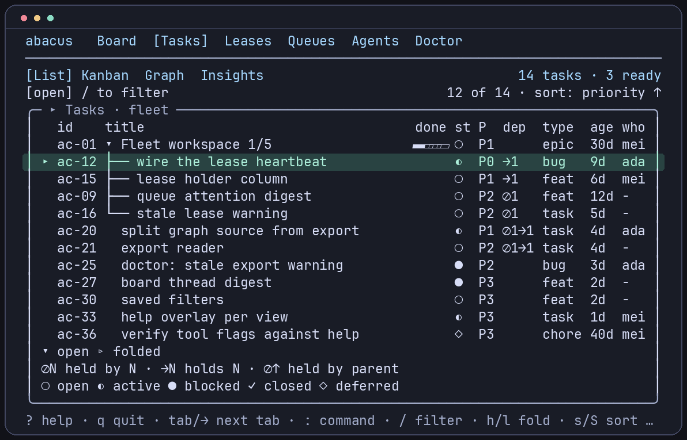

# Abacus

**A terminal dashboard for your coding agents and the work they share.**

See which Beads tasks are ready, where work is blocked, and which agents are on it. Follow leases, queues, and Board conversations from the same terminal.

[Try the demo](#try-the-demo) · [Connect a workspace](#connect-a-workspace) · [Read the docs](docs/README.md) · [See what changed](CHANGELOG.md)



## Try the demo

Download your platform’s archive and `SHA256SUMS` from [Releases](https://github.com/andrew-bierman/abacus/releases/latest). Builds are available for Linux and macOS on x86-64 and ARM64.

For example, on Linux x86-64 you can download and verify v0.6.0 with the GitHub CLI. Run this in an empty directory.

```sh
gh release download v0.6.0 --repo andrew-bierman/abacus \
  --pattern abacus_0.6.0_linux_amd64.tar.gz --pattern SHA256SUMS &&
grep '  abacus_0\.6\.0_linux_amd64\.tar\.gz$' SHA256SUMS | sha256sum -c - &&
tar -xzf abacus_0.6.0_linux_amd64.tar.gz &&
./abacus_0.6.0_linux_amd64/abacus tui --demo
```

On macOS, choose `darwin_arm64` for Apple silicon or `darwin_amd64` for Intel. Run `shasum -a 256` against the archive and compare the output with its entry in `SHA256SUMS` before extracting. Open the extracted directory and run `./abacus tui --demo`. If Gatekeeper blocks the verified binary, clear its quarantine with `xattr -d com.apple.quarantine ./abacus`.

The demo runs on sample data. Press **Tab** to explore the views, **?** for the keys in each view, and **q** to quit.

<details>
<summary>Tasks preview as text</summary>

The Tasks tab shows data from fixture providers:

```
abacus   Board  [Tasks]  Leases  Queues  Agents  Doctor
────────────────────────────────────────────────────────────────────────────────
[List] Kanban  Graph  Insights                                14 tasks · 3 ready
[open] / to filter                                   12 of 14 · sort: priority ↑
╭─ ▸ Tasks · fleet ────────────────────────────────────────────────────────────╮
│   id    title                                  done st P  dep  type  age who │
│   ac-01 ▾ Fleet workspace 1/5                  ▰▱▱▱ ○  P1      epic  30d mei │
│ ▸ ac-12 ├── wire the lease heartbeat                ◐  P0 →1   bug   9d  ada │
│   ac-15 ├── lease holder column                     ○  P1 →1   feat  6d  mei │
│   ac-09 ├── queue attention digest                  ○  P2 ⊘1   feat  12d -   │
│   ac-16 └── stale lease warning                     ○  P2 ⊘1   task  5d  -   │
│   ac-20   split graph source from export            ◐  P1 ⊘1→1 task  4d  ada │
│   ac-21   export reader                             ○  P2 ⊘1→1 task  4d  -   │
│   ac-25   doctor: stale export warning              ●  P2      bug   3d  ada │
│   ac-27   board thread digest                       ●  P3      feat  2d  -   │
│   ac-30   saved filters                             ○  P3      feat  2d  -   │
│   ac-33   help overlay per view                     ◐  P3      task  1d  mei │
│   ac-36   verify tool flags against help            ◇  P3      chore 40d mei │
│                                                                              │
│                                                                              │
│                                                                              │
│                                                                              │
│                                                                              │
│                                                                              │
│                                                                              │
│ ▾ open ▹ folded                                                              │
│ ⊘N held by N · →N holds N · ⊘↑ held by parent                                │
│ ○ open ◐ active ● blocked ✓ closed ◇ deferred                                │
╰──────────────────────────────────────────────────────────────────────────────╯
? help · q quit · tab/→ next tab · : command · / filter · h/l fold · s/S sort …
```

</details>

## Connect a workspace

From the extracted release directory, inspect your setup and confirm the changes you want to make.

```sh
./abacus doctor
./abacus setup --dry-run
./abacus setup
./abacus tui --tab tasks
```

Setup can create a local Beads workspace and configure a lease actor and queues. Start the queue supervisor separately if you need it. For an existing Beads tracker, put the Abacus binary on your `PATH` and run it from the tracker’s workspace, or pass its path with `--tracker`.

| View | What you can see or do |
| --- | --- |
| **Tasks** | Find ready work and blockers in the list, kanban, dependency graph, and insights. |
| **Agents** | See local coding sessions, their repositories and branches, and available activity and quota data. |
| **Leases** | Check which leases are held, stale, or free. |
| **Queues** | Follow Lambe runs and spot failures that need attention. |
| **Board** | Catch up on channels and threads, then preview and confirm posts or replies. |
| **Doctor** | Check provider connections and find setup steps. |

The release bundles Beads, Lambe, beads-lease, the Vercel Board CLI, and abtop. Optional Rex integration connects tasks and runs to terminal sessions. See [built-in tools](docs/built-in-tools.md) and [agent monitoring](docs/agents.md).

## Use Abacus from the CLI

```sh
abacus tasks list --json
abacus agents --json
abacus search release
```

Task changes and Board posts show a plan for confirmation. Add `--dry-run` to preview a write. The [tool contract](docs/tool-contract.md) describes the JSON reports, and the [stdio protocol](docs/serve-protocol.md) covers native clients.

## Contribute

Start with the [development guide](docs/development.md) and [contribution guide](CONTRIBUTING.md). Abacus is licensed under [GPL-3.0-or-later](LICENSE).

## Credits

- [abtop](https://github.com/graykode/abtop) by graykode (MIT): the live agent monitor behind the Agents
  tab's richer detail, and the model for its panels. abacus runs it as a subprocess and imports none of
  its code.
- [gopsutil](https://github.com/shirou/gopsutil) (BSD-3-Clause): the process list.
- [modernc.org/sqlite](https://pkg.go.dev/modernc.org/sqlite) (BSD-3-Clause): reads OpenCode's session database, linked in.
- [agent-deck](https://github.com/asheshgoplani/agent-deck) and [agentsview](https://github.com/wesm/agentsview)
  (MIT): read as references for telling what an agent is doing from its files; no code was used.
