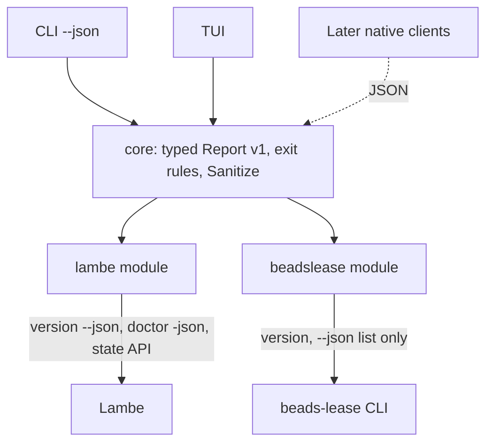

# Abacus Hardening, Typed Core Surface and beads-lease Module - Plan

**Target repo:** `abacus` (`~/Code/abacus`, private `andrew-bierman/abacus`). This plan stacks on the shipped skeleton (draft PR #1) and does not modify Lambe or beads-lease code. `beads-lease` is `andrew-bierman/beads-lease`, read from a local clone at `<beads-lease checkout>`.

## Goal Capsule

- **Objective:** Someone running Beads tooling can trust `abacus` to tell the truth about every tool on their machine, including a broken one, and can see a second tool's state, so that a native macOS or Linux client built later has one dependable, typed source to render.
- **Means:** Harden the existing core first (typed, versioned, safe), then add the beads-lease module through the same module seam (KTD1, KTD6).
- **Authority:** Product Contract, then Planning Contract. Session-settled decisions are not reopened.
- **Stop conditions:** Stop and report if beads-lease cannot be read without invoking a command that writes to or syncs the hub, or if any step would touch the production Lambe daemon, the real hub or real Beads data.
- **Execution profile:** Code, small gitmoji commits, local-first validation (no CI exists in this repo). Branch `feat/hardening-and-second-module`, draft PR only, private repo only.

---

## Product Contract

### Summary

Fix the nine unapplied review findings from the skeleton, make the core's report types strongly typed and its JSON versioned, and add beads-lease (leases on the Beads hub) as the second module. A tool that is installed but cannot run is reported as broken and fails `doctor`.

### Problem Frame

The skeleton works but can mislead: an installed-but-crashing Lambe vanishes from `doctor` with exit 0, a hung `lambe` blocks every command, daemon text can inject terminal escapes, and the Rex handoff can target a shifted row. Core fields such as check statuses are plain strings, which is the wrong foundation for native SwiftUI or other clients that will consume core's JSON. The owner also wants proof that the module seam holds a second, different tool. beads-lease is the real candidate: board-beads is an npm library with no CLI contract, while beads-lease is a Go CLI with `--json list`, stable exit codes, but a text-only `version` and no `doctor`.

### Requirements

**Truthful health reporting**

- R1. A tool that is found but fails to run is reported as broken: `doctor` shows a failing check and exits 1; only a tool that is not found is absent.
- R2. When a tool's own `doctor` exits non-zero but reports no failing check, `abacus doctor` reports a failing check and exits 1.
- R3. Core exit-code rules (0 healthy, 1 a failed check or broken tool, 2 usage) are written once in core and in `docs/tool-contract.md`.
- R4. Subprocess calls to tools have a deadline; a hung tool becomes a failing or warning result, never a hang.

**Typed, versioned core surface**

- R5. Check statuses and detection states are typed values in core, not free strings, at every boundary core exposes to front-ends.
- R6. `abacus ... --json` output carries a `schema_version` so native clients can detect a breaking change.
- R7. A module read that fails returns an error value, not a reason string.

**Safe rendering and interaction**

- R8. Control characters in text that originates outside abacus (tracker titles, daemon messages, doctor output) are removed before reaching any front-end.
- R9. The Rex handoff acts on the run the user selected even when a poll refresh reorders or removes rows, and a failed handoff shows a message.
- R10. Descriptor discovery rejects descriptors with a non-positive pid or empty instance before any process probe, and the empty-identity decision is covered by a test.

**beads-lease module**

- R11. `abacus` detects beads-lease, reads its leases through the module seam (`--json list`), and shows lease holders and expiry in `status` and the TUI.
- R12. The beads-lease module is read-only: it runs only `version` and `--json list`, never acquires, releases, heartbeats, runs, syncs or passes a hub path.
- R13. The missing contract surface of beads-lease (`version --json` with `api_version`, `doctor`) and of board-beads (a CLI exposing the contract at all) is filed as issues on their repos and recorded in the tool-contract doc.

**Safety and workspace**

- R14. Development and tests use fakes and isolated HOME/XDG state; nothing invokes the real beads-lease, Lambe, `rex` or the production coordination hub, and nothing takes window focus.

### Key Decisions

- **Stay in Go; no Rust rewrite or uniffi-rs.** (session-settled: user-approved — chosen over a Rust rewrite with uniffi-rs bindings: the Beads ecosystem is Go and GUIs compose over `--json` and local HTTP, so no FFI is needed.) Governs R5, R6.
- **Core does practically everything and is used type-safely; native thin clients are hand-rolled per framework.** (session-settled: user-directed — chosen over a shared cross-platform UI layer or logic inside front-ends: each native UI kit gives the best UI and core keeps the logic.) Governs R5, R6, R7.
- **Compose tools only through their `--json` CLIs and versioned local APIs; Lambe stays a lean supervisor.** (session-settled: user-directed — chosen over importing tool internals or a mega-platform.) Governs R12.
- **Reuse is ideal but never forced; Beadlane is a source to poach from, not a base.** (session-settled: user-directed — chosen over forcing reuse or building on the Beadlane fork.) Governs R8.
- **Our tools solve their own unique problems (leasing, Vercel Board compatibility, Rex integration via Lambe); where an ecosystem Beads tool does a job better, such as a general dashboard or kanban, use it instead of building it.** (session-settled: user-directed — chosen over building every surface in-house: generalized dashboards and kanban views are a largely solved problem across the Beads ecosystem.) Governs R12; keeps this increment free of any board or kanban UI.
- **Repo stays private, PRs stay draft, commits are small gitmoji commits.** (session-settled: user-directed — chosen over a public repo or large squashed commits.)

### Success Criteria

- With a Lambe binary that exits 2 on `version --json`, `abacus doctor` exits 1 and names Lambe as broken instead of omitting it.
- A fake tool that never returns is cut off at the deadline and shown as failed, and the TUI still starts.
- A tracker title containing an escape sequence renders as plain text in the CLI and the TUI.
- `abacus status --json` output includes `schema_version` and typed statuses, and a test asserts that a module returning an undeclared status has it normalized to `warn`, with no code path emitting a status outside the four typed values.
- With a fake beads-lease, `abacus status` and the TUI list leases; no test invokes the real binary.

### Scope Boundaries

- **Deferred to follow-up work:** a board-beads module once board-beads (or the Vercel Board `vb` CLI) offers a contract surface, which is the owner's priority interest; a survey of ecosystem Beads dashboard and kanban tools to adopt instead of building one; the SwiftUI thin client; third-party Beads tool adapters; releases and packaging; CI for this repo; the final name, brand and mascot (`abacus` stays a placeholder); moving beads-lease to the shared contract (an upstream change).
- **Not built (considered):** a board-beads module in this increment (it is a TypeScript library with no CLI contract, so there is nothing to compose yet); any board or kanban UI in abacus; a `doctor` implementation for beads-lease inside abacus (the upstream tool owns its own doctor); any beads-lease write or sync path; merging the two `signalZero` bodies (they port Lambe's logic and the duplication is cheap); a dedicated beads-lease TUI section (the generic status section is enough until a lease-specific view is requested).
- Lambe and beads-lease code, config and release setup are not modified.

### Open Questions

- Deferred: whether beads-lease should adopt `version --json` and `doctor` exactly as the contract states; the issues filed in U5 carry the question upstream.
- Deferred: whether the Vercel Board `vb` CLI is the better surface to compose for Board compatibility than a new board-beads CLI (it would reuse the ecosystem); to be evaluated before any board-beads module is built.

---

## Planning Contract

### Key Technical Decisions

- KTD1. **A `Broken` detection state.** `core.Broken` means a located binary that cannot run `version`. `DoctorReport` emits a `fail` check for it (R1, R3); `version --json` shows the state. `Absent` stays reserved for not found. Chosen over folding it into `Incompatible` (a warn) because a failing install is a health failure the exit code must show. Governs R1, R3.
- KTD2. **Typed enums in core.** Add `type CheckStatus string` with the four constants, used by `Check.Status`; keep `State` typed. Module adapters map foreign statuses into `CheckStatus` at their edge (unknown becomes `warn`, then R2's backstop applies). Chosen over leaving strings because native clients decode these values. Governs R5.
- KTD3. **Versioned report JSON.** `Report` gains `SchemaVersion int` (`schema_version`, starting at 1). Governs R6.
- KTD4. **Errors, not reason strings.** `lambe.Module.Read` returns `(View, error)` with the existing `ErrNoDaemon` and `ErrAmbiguous` sentinels; `Status()` converts to `core.Status.Unavailable` once. Governs R7.
- KTD5. **Sanitize at the boundary a module owns.** A small `Sanitize` helper in core drops control runes (tab becomes a space); each adapter applies it to external strings after decode and to error text and doctor output, so every front-end gets clean data. Chosen over per-front-end stripping because core owns the logic. Governs R8.
- KTD6. **beads-lease detection uses plain `version`.** beads-lease prints `<name> <version> — <tagline>` and has no `api_version`. Detection runs `version` (no hub access), parses the first two fields, and treats `api_version` as unknown (accepted); the state read runs `--json list` and requires envelope `schemaVersion` 1, otherwise the module reports state unavailable. `shortcut: api_version unknown until beads-lease ships version --json, then require it`. Governs R11, R13.
- KTD7. **Read-only command allowlist for beads-lease.** The module's runner wrapper rejects any argv other than `version` and `--json list`, so no code path can acquire, release, heartbeat, run or sync (R12). Chosen over trusting call sites because the hub is shared and production.
- KTD8. **One exec runner with a deadline, in core.** `Runner` and the exec implementation move to `internal/core` (`core.ExecRunner`) and wrap the context with a 10s timeout (a constant, no env knob) plus `WaitDelay` so a grandchild holding the pipe cannot block after the kill; `lambe` and `beadslease` both use it, so neither can ship without the deadline. Governs R4.

### Assumptions

- Inferred, not user-confirmed: the 10s exec deadline; keeping a descriptor with empty `identity` acceptable (Lambe's spec makes identity optional) while documenting it by test; the `Broken` name; that `schema_version` starts at 1.
- Verified in `<beads-lease checkout>`: `version` prints plain text; `--json list` emits an envelope with `schemaVersion`, `ok`, `leases[]` rows (`resource`, `holder`, `state` of `held|stale|free`, `status`, `expiresAt`, `task`; `unregistered` appears only for a single-resource `status`); exit codes 0/1/2/64/130; no `doctor`; `list` and `status` require the actor env var (`BEADS_ACTOR`) and exit 2 with a usage message without it; `list` calls only `coord list --json` with no write, lock or sync in beads-lease code (the coord wrapper's own behavior for `list` was not inspected); the hub wrapper defaults to the production path `<hub>/bin/coord`, so no test may run the real binary.

### High-Level Technical Design



### Output Structure

```text
internal/beadslease/
  module.go        # detect via `version`, status via `--json list`, doctor skip
  runner.go        # read-only allowlist wrapper
  module_test.go
  testdata/list.json, list-empty.json
internal/core/sanitize.go
internal/core/sanitize_test.go
internal/core/exec.go            # Runner interface and ExecRunner with the deadline
internal/core/exec_test.go
```

---

## Implementation Units

### U1. Typed core surface and versioned report JSON

- **Goal:** Typed statuses and a `schema_version` on every report.
- **Requirements:** R3, R5, R6; KTD2, KTD3.
- **Dependencies:** none.
- **Files:** `internal/core/types.go`, `internal/core/report.go`, `internal/core/core_test.go`, `internal/cli/cli.go`, `internal/cli/cli_test.go`, `internal/lambe/module.go`, `internal/lambe/lambe_test.go`.
- **Approach:**
  - Introduce `CheckStatus` and use it in `Check`, the exit-code rule and the Lambe doctor mapping.
  - Add `SchemaVersion` to `Report`, set to 1 by the three report constructors.
  - Write the exit-code rule once as a doc comment on `ExitCode`.
- **Execution note:** Characterize the current JSON shape in a test first, then change it.
- **Patterns to follow:** existing `core.State` constants and `core_test.go` table tests.
- **Test scenarios:**
  - `doctor --json`, `status --json` and `version --json` all carry `schema_version` 1.
  - A module returning a check with an undeclared status is normalized to `warn` and the report still validates.
  - Existing exit-code table (warn, skip, absent, incompatible exit 0; fail exits 1) still passes unchanged.
- **Verification:** JSON golden checks pass and `go vet` reports no string comparisons against status literals outside core.

### U2. Broken state, tool exit-code backstop and exec deadline

- **Goal:** A broken or hung tool is reported truthfully.
- **Requirements:** R1, R2, R3, R4; KTD1, KTD8.
- **Dependencies:** U1.
- **Files:** `internal/core/types.go`, `internal/core/report.go`, `internal/core/exec.go`, `internal/core/exec_test.go`, `internal/lambe/module.go`, `internal/lambe/lambe_test.go`, `internal/core/core_test.go`, `internal/cli/cli_test.go`.
- **Approach:**
  - Add `core.Broken`; `DoctorReport` emits a fail check naming the tool and the cause; `StatusReport` includes it with no status.
  - In `lambe.Module.Detect`: LookPath failure (or missing explicit `Bin`) is `Absent`; a located binary whose `version --json` errors or exits non-zero is `Broken`; unparsable output stays `Incompatible`.
  - In `Doctor`: keep the exit code; if it is non-zero and no returned check is `fail`, append a synthetic fail check.
  - Move `Runner` and the exec implementation out of `internal/lambe` into `core.ExecRunner`, adding the 10s timeout and `WaitDelay` there; `lambe` consumes it.
- **Test scenarios:**
  - Fake runner exit 2 on `version --json` for a located binary yields `Broken`, `doctor` exits 1, `version --json` shows `broken`.
  - Missing binary still yields `Absent` and exit 0 with no module in doctor output.
  - `doctor -json` exit 1 with only warn checks yields an extra failing check and exit 1.
  - `core.ExecRunner` against a stub command that sleeps past the deadline returns within the deadline with a timeout error, and a stub whose grandchild holds stdout open does not block past `WaitDelay`.
  - A Lambe module whose runner blocks until cancelled reports a failure, not a hang.
- **Verification:** `abacus doctor` with a stub binary that exits 2 exits 1 under an isolated PATH.

### U3. Errors from Read, sanitized external text, discovery guards

- **Goal:** Clean errors, clean text, tested guards.
- **Requirements:** R7, R8, R10; KTD4, KTD5.
- **Dependencies:** U1.
- **Files:** `internal/core/sanitize.go`, `internal/core/sanitize_test.go`, `internal/lambe/module.go`, `internal/lambe/client.go`, `internal/lambe/discover.go`, `internal/lambe/lambe_test.go`, `internal/tui/lambe_section.go`.
- **Approach:**
  - `Read` returns `(View, error)`; `Status()` and the TUI section convert once.
  - `core.Sanitize` removes control runes; apply it to decoded string fields in `View`, to `errorBody.Message` in client errors and to doctor check name, detail and fix.
  - Discovery: skip non-positive pid and empty instance before `PidAlive`; add tests for those and for the empty-identity decision.
- **Test scenarios:**
  - A run title `"ok\x1b]0;pwned\x07"` renders as `ok]0;pwned` with no ESC or BEL byte in `Status().Lines` and the TUI view.
  - An error body message with control bytes is sanitized in the client error text and never contains the token.
  - Descriptors with pid 0, pid -1 and empty instance are skipped and `PidAlive` is not called for them.
  - A descriptor with empty identity is accepted when the pid is alive (documents the Lambe-spec choice).
  - `errors.Is(err, ErrNoDaemon)` works through `Read` for an empty state dir.
- **Verification:** no raw control byte appears in any rendered output of the existing TUI tests.

### U4. TUI selection by run identity and handoff error notice

- **Goal:** `o` acts on the run the user selected.
- **Requirements:** R9.
- **Dependencies:** U3.
- **Files:** `internal/tui/lambe_section.go`, `internal/tui/model.go`, `internal/tui/lambe_section_test.go`.
- **Approach:**
  - Store the selected run's `Issue` (and `Session` when present); after each view update find its index, falling back to the clamped index when it disappears.
  - The handoff callback returns a `handoffDoneMsg{err}`; the section shows `rex: <error>` in its notice line.
- **Test scenarios:**
  - Runs `[A,B,C]`, cursor on B, next view is `[B,C]`: `o` hands off B's machine, not C's.
  - Selected run removed: cursor falls back to the clamped index and `o` uses that run.
  - A handoff done message carrying an error sets the notice; a nil error clears nothing and shows nothing.
- **Verification:** the existing handoff tests still pass.

### U5. File beads-lease contract-gap issues

- **Goal:** The upstream gaps are tracked where they will be fixed.
- **Requirements:** R13.
- **Dependencies:** none.
- **Files:** none in this repo; the issue URLs are recorded in `docs/tool-contract.md` in U7.
- **Approach:**
  - Re-verify the gaps against `<beads-lease checkout>` help output (no hub access), then open two issues on `andrew-bierman/beads-lease`: `version --json` with `api_version`, and a `doctor [--json]` command with the contract's check shape and exit rule.
  - Open one issue on `andrew-bierman/board-beads` asking for a thin CLI that meets the tool contract (`version --json`, `doctor`), and noting the Vercel Board `vb` CLI as an alternative surface to evaluate.
- **Test expectation:** none -- external issue filing, no behavior in this repo.
- **Verification:** all three issue URLs resolve.

### U6. beads-lease module

- **Goal:** The second module behind the same seam.
- **Requirements:** R11, R12, R14; KTD6, KTD7.
- **Dependencies:** U1, U2, U3.
- **Files:** `internal/beadslease/module.go`, `internal/beadslease/runner.go`, `internal/beadslease/module_test.go`, `internal/beadslease/testdata/list.json`, `internal/beadslease/testdata/list-empty.json`, `cmd/abacus/main.go`, `internal/tui/model.go`.
- **Approach:**
  - Wrap `core.ExecRunner` (KTD8) in the allowlist so the deadline applies to every call.
  - `Detect`: run `version`; parse `<name> <version> — ...`; not found is `Absent`, run failure is `Broken`, unrecognized text is `Incompatible`; `api_version` stays 0 (unknown) per KTD6.
  - `Doctor`: one `skip` check, "beads-lease provides no doctor yet", so the module is listed without a false health claim.
  - `Status`: run `--json list`; require envelope `schemaVersion` 1 and `ok`; summarize "N held, S stale, M free"; one line per lease with holder, expiry and a stale marker where it applies; a non-zero exit or bad envelope becomes `Unavailable` carrying the tool's sanitized error message (for example the missing actor variable); sanitize text.
  - The actor env var is inherited from the caller's environment: abacus never sets it, because it is the claiming identity.
  - The runner wrapper accepts only `version` and `--json list` (KTD7); the binary path comes from `ABACUS_BEADSLEASE_BIN` or PATH; no hub path is passed.
  - Register the module in `main.go` after Lambe; the TUI uses the generic section.
  - Fixtures are derived from beads-lease's `LeaseRow` and `Envelope` types (source-derived, not captured from the production hub).
- **Execution note:** Decode fixtures first; they are the contract.
- **Test scenarios:**
  - `version` output `beads-lease 0.1.0 — the fleet's keeper of leases` yields Ready with version 0.1.0.
  - Missing binary is Absent; exit 1 on `version` is Broken; unrelated text is Incompatible.
  - `list.json` produces the summary and lines (held with holder and expiry, stale with holder and stale marker, free); `list-empty.json` produces "0 held, 0 stale, 0 free".
  - Envelope `schemaVersion` 2 or `ok:false` yields Unavailable with a reason, not an error.
  - A usage error (exit 2, envelope message about the missing actor variable) yields Unavailable naming that variable, with no control characters in the text.
  - A blocking fake `--json list` returns Unavailable within the deadline.
  - The allowlist wrapper returns an error for `acquire`, `release`, `heartbeat`, `run`, `status` and `sync`, and a recording fake shows only `version` and `--json list` were ever executed during a full detect, doctor and status pass.
  - Integration: `abacus status --json` with both fake modules lists both and exits 0.
- **Verification:** `go test ./internal/beadslease/...` passes with an isolated HOME and PATH containing no real beads-lease.

### U7. Contract doc, README and PR record

- **Goal:** Docs match behavior.
- **Requirements:** R3, R13.
- **Dependencies:** U1 through U6.
- **Files:** `docs/tool-contract.md`, `README.md`.
- **Approach:**
  - Document the `broken` state and the exit rule, the beads-lease precondition (the caller's actor env var must be set), the typed statuses and `schema_version`, the beads-lease shortcut and its two upstream issues, the board-beads issue, and the `ABACUS_BEADSLEASE_BIN` override.
  - Mark the signalZero duplication as intentionally kept, with the reason.
- **Test expectation:** none -- documentation; each documented rule is exercised by a U1 to U6 test.
- **Verification:** every rule in the doc cites a test or an upstream document.

---

## Verification Contract

| Check | Command | Applies to |
|---|---|---|
| Build | `go build ./...` | all units |
| Vet and format | `go vet ./...` and `gofmt -l .` empty | all units |
| Tests | `go test -count=1 ./...` with `HOME`, `XDG_STATE_HOME`, `XDG_CONFIG_HOME` set to a temp dir, a private `GOCACHE`, `GOMODCACHE=$HOME/go/pkg/mod` from the real home | U1 to U6 |
| Isolation | grep of tests shows no path under `~/.local/state/lambe`, `~/.local/bin`, `<hub>`; PATH for tests contains no real `beads-lease` or `lambe` | U2, U3, U6 |
| Read-only | the beads-lease recording-fake test | U6 |
| Architecture | `TestLogicPackagesImportNoUI` extended to cover `internal/beadslease` | U6 |

## Definition of Done

- All units' verification passes and every R has a test or doc anchor.
- No production hub, daemon, state, binary or Beads data was read or written; no app was launched or focused.
- Dead-end or experimental code from abandoned approaches is removed from the diff.
- Commits are small and gitmoji-prefixed; the PR is a draft against the stacked base.
- The two beads-lease issues are filed and linked from `docs/tool-contract.md`, and Lambe and beads-lease code is unchanged.
