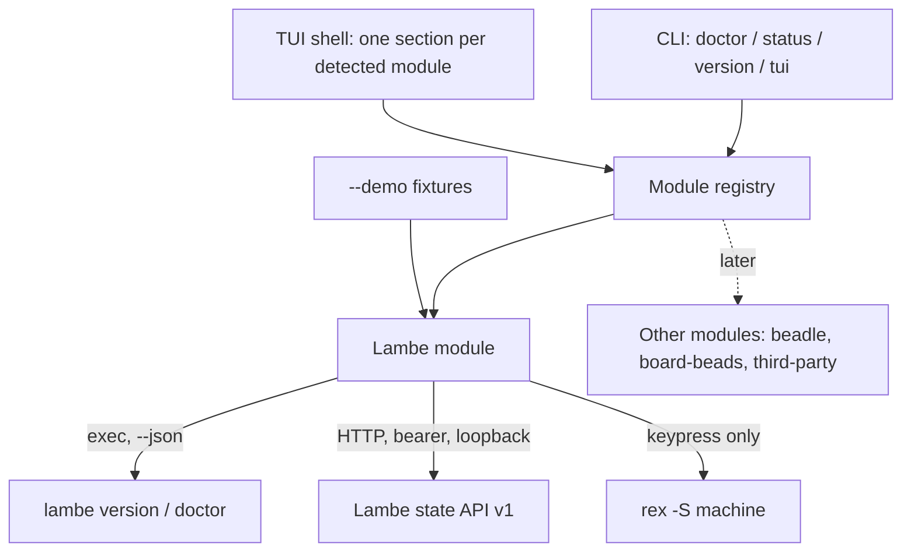

# Umbrella CLI/TUI for the Beads Tool Family (Walking Skeleton) - Plan

**Target repo:** `beaddeck` (working name, local-only, `~/Code/beaddeck`). Lambe lives at `~/Code/lambe` and is read, never modified, by this plan.

## Goal Capsule

- **Objective:** Someone running Beads-based agent tooling can install one terminal tool, see which of the family's tools are present and healthy, and watch their state in one place, on macOS or Linux.
- **Means:** One thin Go binary that composes tools only through their `--json` CLIs and versioned local APIs (KTD1, KTD2).
- **Authority:** Product Contract, then Planning Contract. Session-settled decisions are not reopened.
- **Stop conditions:** Stop and report if Lambe's `version --json` or state API cannot support a detect/doctor/status/TUI slice without changes to Lambe's contract, or if any step would touch the production daemon or real Beads data.
- **Execution profile:** Code. Local commits only; drafts only for any PR; no pushes or GitHub repo creation without the owner's go.

---

## Product Contract

### Summary

A first slice of one umbrella binary, with `doctor`, `status`, `version` and a TUI. It detects installed Beads tools, shows one section per detected tool, and ships Lambe (queue, runs, attention) as the first module behind a small module interface. A short tool-contract doc defines what any tool must expose to be composable, with Lambe as the reference.

### Problem Frame

The Beads tools (Lambe, beadle, board-beads, plus third-party ones) each have their own CLI or TUI, or none, so there is no single install-and-go entry point. A SwiftUI app first would tie the "full setup" experience to macOS and grow UI code that has to be maintained. A terminal-first umbrella keeps logic and UI surface small, works on Linux, and gives a later SwiftUI app or other GUI a thin client role over the same contract.

### Requirements

**Detection and composition**

- R1. The umbrella detects each known tool by locating its binary and reading `version --json`, and reports the tool as absent, incompatible (unsupported `api_version`), or ready.
- R2. Tools are composed only through their `--json` CLIs and versioned local APIs; the umbrella holds no tracker, queue, or supervisor logic of its own.
- R3. A module interface lets a new tool plug in with detection, doctor, status, and a TUI section, without changing the CLI or TUI shell.

**CLI**

- R4. `doctor` aggregates each detected module's health checks; `status` aggregates each module's state summary; both support `--json`.
- R5. Exit codes are stable and documented: 0 healthy, 1 a check failed, 2 usage error.
- R6. A tool that is absent is reported as such, not as an error, and does not change the exit code.

**TUI**

- R7. The TUI shows one section per detected module and nothing for absent ones, with a text-only splash and no mascot art.
- R8. The Lambe section shows queue, runs, and attention items read from the state API, read-only.
- R9. A `--demo` mode renders the TUI from fixture data with no daemon, tool, or network.
- R10. A keypress in the Lambe section hands off a machine to Rex (`rex -S <machine>`); the handoff lives in the Lambe module and never runs without that keypress.

**Lambe module and contract**

- R11. The Lambe module reads state through the descriptor-discovery and hardening rules in Lambe's `docs/api/state-api.md` (loopback host check before sending the token, no redirects, bounded timeouts, token never logged or printed).
- R12. The module is read-only: it never calls `POST /api/v1/refresh`.
- R13. A short tool-contract doc defines the composable-tool surface (`version --json` with `api_version`, `doctor`, `--json` reads, stable exit codes, config/state discovery, optional local API), with Lambe as the reference and a list of Lambe gaps found.

**Safety and workspace**

- R14. All development and tests use an isolated HOME/XDG/config/state and never touch the production daemon, its state, its binary, or real Beads data; nothing launches an app or takes focus.

### Key Decisions

- **Umbrella CLI/TUI first, then the SwiftUI app.** (session-settled: user-directed — chosen over a contract-only approach with no umbrella binary, and over the handoff's app-first order: the TUI keeps logic lean and covers Linux.) Governs R2, R7.
- **Compose through CLIs and local APIs; Lambe stays a lean supervisor, not the umbrella.** (session-settled: user-directed — chosen over a mega-platform or Lambe as the umbrella: modular tools users can grab alone plus one collective tool.) Governs R1, R2, R3.
- **When our tools limit us, open GitHub issues on their repos and enhance them; third-party Beads tools may be pulled in later.** (session-settled: user-directed — chosen over building everything in-house or forking silently: many Beads tools already exist.) Governs R13.
- **First build is a walking skeleton.** (session-settled: user-approved — chosen over also building beadle/board-beads modules or third-party adapters now: prove the module interface with the one tool that already has a state API.) Governs R3, R8.
- **Beadlane is a source to poach pieces from, not a base to build on, and the app leans terminal-side to cut UI code to maintain.** (session-settled: user-directed — chosen over refining the Beadlane fork as the foundation: it is a heavily diverged fork and the owner wants less UI code to own.) Governs R7; keeps the later SwiftUI client thin.

### Success Criteria

- On a machine with Lambe installed and its state API enabled, `doctor`, `status`, and the TUI show Lambe's real state; on a machine without Lambe they report it absent and exit 0.
- A second module could be added by implementing the module interface alone, shown by a test-only fake module registered in the CLI and TUI tests.
- The tool-contract doc lets a tool author decide, from the doc alone, whether their tool is composable.

### Scope Boundaries

- **Deferred to follow-up work:** the SwiftUI app as a thin client; extracting LambeDash from Lambe; vendored-fixture drift CI; app CI and releases; deleting `apps/dashboard` from Lambe; beadle and board-beads modules; third-party Beads tool adapters; mascot art and wordmark; the final name and brand.
- **Not built (considered):** mutating actions (retry, cancel, nudge, refresh) — Lambe's API is read-only by design and a write path needs an explicit owner decision; a plugin-loading system for out-of-tree modules — modules are compiled in until a second real consumer exists; a config file for the umbrella — detection by PATH plus env overrides is enough for the skeleton.
- Lambe's code, config, release setup, and production daemon are not modified.

### Open Questions

- Deferred: final umbrella name and brand (reasonably unique; dinosaur versus bead mascot). The working name `beaddeck` is defined in the brand constant and the module path, plus the `cmd/` directory name (KTD3), so the rename is mechanical; resolve before the first push or public repo.

---

## Planning Contract

### Key Technical Decisions

- KTD1. **Go, standard-library `flag` subcommands, Bubble Tea for the TUI.** Matches Lambe's stack (`go 1.26`, `bubbletea v1.3.10`, `lipgloss v1.1.0`, `bubbles v1.0.0`) so code and skills transfer, and one static binary installs on macOS and Linux. Implements R1–R9.
- KTD2. **The umbrella decodes Lambe's wire contract from vendored fixtures; it does not import Lambe code.** Lambe's DTOs are in `internal/httpstate`, which Go forbids importing, and importing would couple release cadence. The fixtures from `testdata/contract/v1` are copied under `internal/lambe/testdata/contract/v1` with a note naming the Lambe version they came from; decoding tests run against them. Unknown fields are ignored and absent means unknown, per the API doc. Governs R2, R11.
- KTD3. **Working name in one place.** The module path, binary name, and user-visible product string come from a single `internal/brand` constant plus the `go.mod` module path, so the name decision changes two places. Repo stays local until the name is chosen.
- KTD4. **Module interface is the only extension seam.** Each module exposes: an ID and display name, `Detect(ctx)` returning absent/incompatible/ready plus version info, `Doctor(ctx)` returning check results, `Status(ctx)` returning a summary, and a TUI section model. The CLI and TUI iterate a registry and never name a tool. Governs R3.
- KTD5. **Process boundaries are injectable.** Command execution, HTTP, filesystem discovery, and the Rex handoff go through small interfaces with fakes, so tests run with no real Lambe, daemon, or Rex and never take focus. Governs R9, R10, R14.
- KTD6. **Umbrella exit codes follow Lambe's:** 0 ok, 1 a check failed (Lambe's `doctor` already exits 1 only on a `fail` status), 2 usage. `warn` and `skip` do not fail. A tool the umbrella finds incompatible (unsupported `api_version`) is reported as a `warn` check, so it does not change the exit code. A module that is ready but whose state is unavailable (API disabled, no live daemon, ambiguous daemon) is reported with a reason and also exits 0. Lambe's own check statuses pass through unchanged, so an unconfigured Lambe (its `config` check is a `fail`) exits 1. Governs R5, R6.
- KTD7. **License defaults to GPL-3.0-or-later**, matching Lambe, until the owner says otherwise (the handoff's default for app code). Any Beadlane (MIT) code poached later carries MIT attribution.

### Assumptions

- Inferred, not user-confirmed: Go and the TUI library choice (KTD1); the exit-code scheme (KTD6); the license default (KTD7); `beaddeck` as the working name; `lambe doctor -json` and `lambe version --json` are the stable machine surfaces (verified present: `version --json` returns `version`, `commit`, `date`, `api_version`; `doctor -json` exists with `name`, `status`, `detail`, `fix`).
- Verified gaps in Lambe as of v0.10.0, to be rechecked when implemented: `lambe status` offers no `--json`, and no command prints the state dir or descriptor path. Both are filed as issues on Lambe (R13), not worked around inside Lambe.

### High-Level Technical Design



Discovery for the Lambe module follows the state-API doc: enumerate `stateapi-*.json` in `<state-dir>/live/`, skip stale or non-loopback entries before reading the token, select by instance or config path, re-enumerate on repeated failure. The state dir comes from an explicit flag or env override first, then Lambe's documented default; the skeleton never guesses beyond that.

### Output Structure

```text
beaddeck/
  go.mod
  LICENSE
  README.md
  cmd/beaddeck/main.go
  internal/brand/brand.go
  internal/module/        # interface, registry, result types
  internal/lambe/         # detect, doctor, state client, Rex handoff
  internal/lambe/testdata/contract/v1/
  internal/cli/           # doctor, status, version, exit codes, --json
  internal/tui/           # shell, sections, demo mode, splash
  docs/tool-contract.md
  docs/plans/
```

---

## Implementation Units

### U1. Repo bootstrap and brand seam

- **Goal:** A buildable local Go repo with the working name isolated.
- **Requirements:** R14; KTD1, KTD3, KTD7.
- **Dependencies:** none.
- **Files:** `go.mod`, `LICENSE`, `README.md`, `.gitignore`, `cmd/beaddeck/main.go`, `internal/brand/brand.go`, `internal/brand/brand_test.go`.
- **Approach:**
  - Initialize the module under `github.com/andrew-bierman/beaddeck` with Go 1.26 to match Lambe; no remote is added.
  - `main` dispatches subcommands and prints usage on none, exiting 2.
  - README states the working-name status and the isolation rules for development.
- **Test scenarios:**
  - No args prints usage naming `version`, `doctor`, `status`, `tui` and exits 2.
  - Unknown subcommand exits 2 with the usage text.
  - The product-name string literal appears only in `internal/brand/brand.go` in non-test Go code (import paths and the `cmd/` directory name are excluded).
- **Verification:** `go build ./...` and `go vet ./...` pass; `git remote` prints nothing.

### U2. Module interface and registry

- **Goal:** The single seam every tool plugs into.
- **Requirements:** R1, R3, R6; KTD4, KTD5.
- **Dependencies:** U1.
- **Files:** `internal/module/module.go`, `internal/module/registry.go`, `internal/module/module_test.go`.
- **Approach:**
  - Define detection states (absent, incompatible, ready) and result types shared by doctor and status, including JSON tags.
  - Registry returns modules in a fixed order and runs detection once per invocation.
  - Provide an in-package fake module used by CLI and TUI tests.
- **Patterns to follow:** Lambe's doctor result shape in `cmd/lambe/doctor.go` (`name`, `status`, `detail`, `fix`, statuses `ok`/`warn`/`fail`/`skip`).
- **Test scenarios:**
  - A registry with a ready, an absent, and an incompatible fake reports each state in order.
  - An absent module contributes no doctor or status results and no error.
  - Detection runs once per module per invocation.
- **Verification:** Package tests pass with no network, PATH, or HOME dependence.

### U3. Lambe module: detect, doctor, state client

- **Goal:** The first real module, composing Lambe through its CLI and API.
- **Requirements:** R1, R2, R4, R6, R8, R11, R12, R14; KTD2, KTD5, KTD6.
- **Dependencies:** U2.
- **Files:** `internal/lambe/detect.go`, `internal/lambe/doctor.go`, `internal/lambe/client.go`, `internal/lambe/discover.go`, `internal/lambe/identity_darwin.go`, `internal/lambe/identity_linux.go`, `internal/lambe/identity_other.go`, `internal/lambe/dto.go`, `internal/lambe/*_test.go`, `internal/lambe/testdata/contract/v1/*.json`, `internal/lambe/testdata/README.md`.
- **Approach:**
  - Detection locates `lambe` via an env-overridable binary path, runs `version --json`, and compares `api_version` to the supported set (1).
  - Doctor runs `lambe doctor -json`, maps its checks into module results, and treats exit 1 with parseable JSON as failed checks rather than a process error.
  - Discovery and the client implement the state-API doc's algorithm and client duties; DTOs mirror the vendored fixtures with lists tolerant of `null` and `[]`.
  - The client has no method for the refresh route.
  - Discovery also checks the descriptor's process `identity` against the live pid's identity (pids are recycled), with darwin and linux implementations and a fail-closed fallback that skips the entry elsewhere. Read Lambe's `internal/stateapi/client.go` and `internal/proc/identity_*.go` as the reference to port, not to import.
  - A daemon selector (env `BEADDECK_LAMBE_CONFIG` and a `--lambe-config` flag) is passed to `lambe doctor -config` and matched against descriptor `config_path` or `instance`. Several matching descriptors and no selector yield an ambiguous result, never the first match.
  - A module that is ready but has no usable descriptor reports a state-unavailable result carrying the reason (API disabled, no live daemon, ambiguous).
- **Patterns to follow:** Lambe's `internal/stateapi/client.go` (Resolve, Selector, ambiguity error).
- **Execution note:** Decode the vendored fixtures test-first; they are the contract.
- **Test scenarios:**
  - Each vendored fixture (`snapshot`, `queue`, `history`, `issue`, `error`, `descriptor`) decodes, with `null` and `[]` lists equivalent.
  - Unknown extra fields in a fixture are ignored; an absent optional field decodes as unknown, not as an empty value.
  - `version --json` with `api_version` 2 yields incompatible; missing binary yields absent; garbled output yields an error naming the command, not the token or paths beyond the binary.
  - Discovery skips a stale pid, a non-`127.0.0.1` `addr` (checked before the token is read into a request), and a malformed file, and selects by instance when several exist.
  - A descriptor whose `identity` does not match the live process with that pid is skipped before its token is read.
  - Two descriptors with no selector yield an ambiguous state-unavailable result; with a matching `config_path` selector the right one is chosen.
  - An empty `live/` directory and a stale-only directory both yield state-unavailable with a reason, not an error.
  - A 3xx response is an error and is never followed; a request exceeding the timeout fails fast; the token never appears in any returned error or log line.
  - Covers R12. The client exposes no refresh call, and a fake server asserts no `POST` is ever received during a full status read.
  - Doctor mapping: a `fail` check yields exit 1 semantics; `warn` and `skip` do not.
  - Integration: against an `httptest` server serving the fixtures behind bearer auth, a full status read returns the snapshot, queue, and history.
- **Verification:** Tests pass with an isolated HOME; no test reads `~/.local/state/lambe`, `~/.local/bin/lambe`, or `~/Code/agent-coordination/lambe.yaml`.

### U4. CLI: version, doctor, status

- **Goal:** The scriptable surface with stable exit codes and JSON.
- **Requirements:** R4, R5, R6; KTD6.
- **Dependencies:** U2, U3.
- **Files:** `internal/cli/cli.go`, `internal/cli/doctor.go`, `internal/cli/status.go`, `internal/cli/version.go`, `internal/cli/*_test.go`, `cmd/beaddeck/main.go`.
- **Approach:**
  - Each command iterates the registry; text output is for humans, `--json` emits one document with the umbrella's version and a per-module array.
  - Exit code derives only from `fail` results and usage errors.
- **Test scenarios:**
  - With only a ready fake module reporting `ok`, `doctor` exits 0 and `--json` parses with one module entry.
  - A `fail` check exits 1; `warn` and `skip` exit 0.
  - With no modules detected, `doctor` and `status` exit 0, print that nothing was detected, and `--json` yields an empty modules array.
  - `version --json` includes the umbrella version and each module's detection state and tool version.
  - A bad flag exits 2.
  - An incompatible module yields a `warn` and exit 0; a ready module with state unavailable prints the reason, exits 0, and carries the reason in `--json`.
  - A Lambe `config` check of `fail` passes through and exits 1.
- **Verification:** `go test ./internal/cli/...` passes; running the built binary with an empty PATH and isolated HOME exits 0 for `doctor`.

### U5. TUI shell, Lambe section, demo mode, Rex handoff

- **Goal:** The interactive surface, one section per detected module.
- **Requirements:** R7, R8, R9, R10, R14; KTD1, KTD5.
- **Dependencies:** U2, U3.
- **Files:** `internal/tui/model.go`, `internal/tui/splash.go`, `internal/tui/lambe_section.go`, `internal/tui/demo.go`, `internal/lambe/rex.go`, `internal/tui/*_test.go`, `internal/lambe/rex_test.go`, `internal/cli/tui.go`.
- **Approach:**
  - The shell lists detected modules as tabs or a sidebar, renders the selected module's section, and shows a text splash on start.
  - The Lambe section polls the state client on a modest interval and shows runs, queue, attention, and the stalled flag, read-only.
  - `--demo` swaps the Lambe module's dependencies for fixture-backed fakes.
  - The Rex handoff is a function on the Lambe module behind an injectable runner, invoked only from a keypress on a selected run's machine.
- **Patterns to follow:** Lambe's own `lambe tui` split-pane approach in `cmd/lambe` and its TUI package use of `bubbles`.
- **Test scenarios:**
  - Driving the model with scripted messages: only detected modules appear; an absent module has no section.
  - Demo mode renders runs, queue, and attention from fixtures with no network, binary, or HOME access.
  - The Lambe section never issues a mutating request and shows an unavailable state, not a crash, when the API disappears mid-session.
  - Pressing the handoff key on a selected run calls the injected runner once with `rex -S <machine>`; no other message or startup path calls it.
  - Pressing the handoff key on a run with no `machine` does nothing and shows a notice; the runner is not called.
  - Resizing to a narrow width still renders without panic.
- **Verification:** Model tests pass headless; a manual `beaddeck tui --demo` check is run only with the window-capture-free rules in the Safety requirement (no focus stealing; a pty-driven smoke run is acceptable).

### U6. Tool contract doc and Lambe gap issues

- **Goal:** The written contract and the upstream gaps recorded where the owner will see them.
- **Requirements:** R13; KTD2.
- **Dependencies:** U3, U4.
- **Files:** `docs/tool-contract.md`, `README.md`.
- **Approach:**
  - The doc covers `version --json` with `api_version`, `doctor` and `doctor --json` result shape and exit codes, `--json` reads, config/state discovery, and the optional `serve` local API with auth and loopback duties, citing Lambe's `docs/api/state-api.md` as the owned reference rather than restating it.
  - Re-run the gap check against the installed Lambe's help output (no daemon contact), then open issues on `andrew-bierman/lambe` for each confirmed gap: no `--json` on `status`, and no way to print the state dir or descriptor path. Record the issue URLs in the doc.
- **Test expectation:** none -- documentation and issue filing; correctness is reviewed against U3's behavior.
- **Verification:** Every contract rule in the doc is exercised by a U3 or U4 test or cites Lambe's doc; issue URLs resolve.

---

## Verification Contract

| Check | Command | Applies to |
|---|---|---|
| Build | `go build ./...` | all units |
| Vet | `go vet ./...` | all units |
| Tests | `go test ./...` with `HOME`, `XDG_CONFIG_HOME`, `XDG_STATE_HOME` set to a temp dir and a private `GOCACHE` | U1–U5 |
| Isolation | grep of the test tree shows no reference to the production paths listed in U3's verification (`~/.local/state/lambe`, `~/.local/bin/lambe`, `~/Code/agent-coordination/lambe.yaml`) | U3, U5 |
| No remote | `git remote` is empty until the owner picks a name | all units |

## Definition of Done

- All units' verification passes and every R has at least one test or doc anchor.
- No production daemon, state, binary, or Beads data was read or written; no app was launched or focused.
- Dead-end or experimental code from abandoned approaches is removed from the diff.
- The brand constant and module path are the only places the working name is defined.
- Lambe gap issues are filed and linked, and nothing in `~/Code/lambe` changed.
- Any PR is a draft; commits use gitmoji and conventional prefixes.
