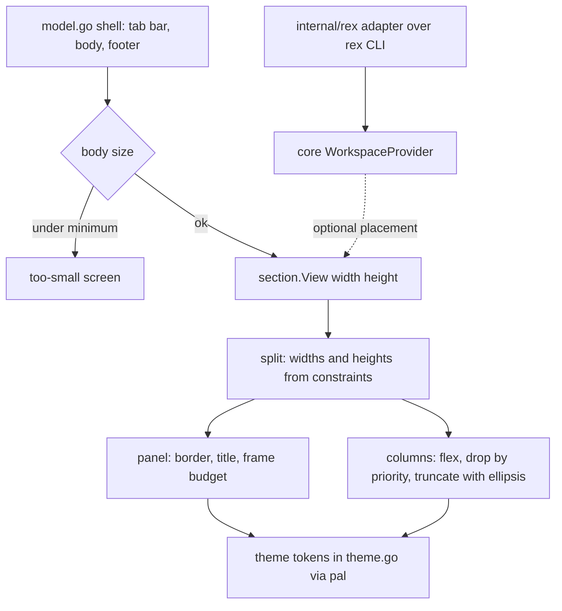

# feat: Responsive TUI redesign and an optional workspace (Rex) layer

## Goal Capsule

- **Objective:** Someone running abacus in any terminal from 40x12 to a 200x60 window sees a polished, readable cockpit for their agent fleet: every tab is laid out for the space it has, nothing overflows the terminal, identifying fields (ids, states, thread numbers) are never clipped, and the same information is available to a future native app from the same core.
- **Means:** Shared layout and theme primitives in `internal/tui`, applied tab by tab (KTD1, KTD2, KTD3); the optional workspace layer lives in core behind a provider interface (KTD6).
- **Authority:** the owner's directions in this session (beautiful, perfect, fully responsive; strong core with the TUI as a tasteful layer; optional strong Rex support; strong tests; pre-1.0 versions), then the handoff rules at `~/Code/_handoff/abacus-handoff.md` (safety, write gate, review gate), then this plan.
- **Stop conditions:** stop and report if any test or command would run `bd`, `bv`, `lambe`, `beads-lease`, `board`, `rex` or `rex-tui` against real data or a live session; if a redesign step needs to change an existing keybinding or write-gate behavior (the additive workspace jump key `w` in U13 is expected); or if a guard test (architecture, theme, tool names) has to be weakened rather than satisfied.
- **Execution profile:** four PRs in order, each a draft PR against `main`, independently reviewed, merged by the agent (the owner authorized it), with a CHANGELOG entry and a pre-1.0 version note. The owner runs `./bin/abacus tui --demo` from `main` after each merge. Linux is the verification target; macOS and Windows are assumed to follow because the code is pure Go with no terminal-specific calls added.
- **Finishes and ships:** the agent implements, reviews, merges and rebuilds `bin/abacus`; publishing a release stays an owner action.

---

## Product Contract

### Summary

Rebuild how every tab is drawn, on top of a core that already holds the data. Add panels, aligned flexing columns, clear hierarchy and real breakpoints. Add an optional "workspace" capability to core so a run, lease or task can show and open the terminal session that hosts it, with Rex as the first provider.

### Problem Frame

The TUI works but looks like a log. Verified from `internal/tui/testdata/golden` and tmux at 100x32 and 60x24: no panels or borders, a single weight of text, fixed-width columns cut with an ellipsis (`(held) ac-zoj by glm-scheduler-01 (ex…`), and a 30-row terminal that is mostly empty. Only Queues uses a side-by-side layout; Board, Tasks, Leases and Doctor are single-column line lists with `padTo(trunc(x, N), N)` literals. Breakpoints are scattered numbers (`wideBreakpoint=100`, brand at 60, header rule at height 16). The owner wants this to be the tasteful, responsive first client over core before native Swift, Linux and Windows apps arrive.

The owner also wants strong but optional Rex support. Today abacus only offers `rex -S <machine>` from a Queues run.

### Requirements

**Layout and responsiveness**

- R1. A layout vocabulary of panels (bordered, titled), aligned tables whose columns flex with width, and a width-and-height-aware split exists once and every tab uses it; no tab hand-rolls column widths.
- R2. Explicit, named breakpoints (about 40, 60, 80, 100 and 140 columns; short and tall heights) decide what each tab shows: single pane and fewer columns when narrow, a detail pane beside the list from 100 columns, extra columns and a summary strip when wide, and extra height used instead of left empty.
- R3. Below 40 columns or 12 rows the body shows a plain "terminal too small" message instead of a broken layout. The tab bar stays row 0 and the footer stays the last row wherever the existing chrome tests already require them (down to width 40, and the height-2 and height-3 cases); the message replaces only the body.
- R4. No rendered line is wider than the terminal, at any size from 1x1 to 300x100, with any provider string (wide runes, combining marks, escapes, bidi controls).

**Look and theme**

- R5. One coherent theme: rounded borders with focus shown by border color and weight, a semantic palette that holds on truecolor, 256, 16 colors and `NO_COLOR`, light and dark backgrounds, and structure that never depends on color alone.
- R6. Every tab has a clear hierarchy: a title and state line, the primary list or table, and a secondary detail or summary region, in the same order and with the same spacing across tabs.
- R7. Tab bar, footer key hints, help overlay, confirm screens and first-run setup prompts use the same primitives and match the new look.

**Behavior that must not change**

- R8. Existing keybindings, tab order, write-gate confirm flows and CLI output are unchanged, and JSON stays at `schema_version` 1 with only the additive workspace fields of R10. The only new key is the workspace jump key of R12. Provider text still goes through the sanitizers. UI libraries stay inside `internal/tui`.
- R9. No tool name appears in navigation, headers, labels or footer; the new panel titles are domain words.

**Workspace layer (optional)**

- R10. Core exposes an optional workspace capability: where an item (run, lease, task, queue row) lives as a terminal session and tab, and a plan to open it. It is additive JSON and absent without error when no provider exists.
- R11. A Rex adapter provides it by composing Rex's public CLI only (argv allowlist, no Rex code imported). Rex absent, unreachable, an unsupported API revision or an ambiguous match each produce "not connected, how to connect" or an honest "unknown", never a failure of the cockpit.
- R12. The TUI shows the hosting session on rows that have one and offers a jump key: the existing `o` ("open session") on Queues and the new, unbound `w` on Leases and Tasks (a test proves `w` is unbound in every tab and overlay). The jump runs on an explicit keypress only; the ladder is the existing `rex -S <machine>` handoff, then showing the command to copy. Each outcome (opened, not connected with how to connect, ambiguous with candidates, command shown) gives a one-line status and a footer hint. The UI says "workspace"; Rex is named only in Doctor, how-to-connect and error text.

**Quality bar**

- R13. Strong tests at every layer: goldens at several widths and heights per tab, a width and height property test, hostile-string tests, color-profile tests, and a compiling mutant for each new guard.

### Success Criteria

- Run at 100x32, 60x24, 40x12 and 160x50 in tmux: each tab looks intentional, uses the space, and the owner's first reaction is not "this is plain".
- The property test finds no line wider than the terminal across the size grid; the existing theme, tool-name and architecture guards pass unchanged in intent.
- With no Rex on the machine, the cockpit behaves exactly as today plus a skip line in Doctor.

### Scope Boundaries

**Deferred to follow-up work**

- Native issue graph for Tasks insights: import bv's `pkg/analysis` (pinned, behind an adapter) in place of the `bv` subprocess, covering PageRank, critical path, cycles, ready and blocked, and next pick; reimplement bv's remaining viewer features in abacus's own TUI over time. See KTD7.
- Importing b9s's UI or the Beads library (rejected, KTD7).
- Rex features beyond R10 to R12 (placement lookup, the Rex adapter and the jump key): `rex window focus`, `rex window new` and `session.select` rungs (each needs its argv and JSON shape verified against a real Rex first), badge publishing, polling `program_status`, host discovery through `hosts`, multi-host awareness.
- Lip Gloss and Bubble Tea v2.
- Native app clients (they will consume core's JSON; nothing here changes the JSON except the additive workspace fields).

**Outside this plan**

- Windows verification (the plan assumes it follows; the Windows plan in `docs/plans/` still applies).
- Mouse support, new tabs, new write verbs, the `bd` write path.

### Key Decisions

- Keep Go, Bubble Tea v1.3.x and Lip Gloss v1.1.x and the existing `section` and `Theme` architecture. Governs R1, R5, R8.
- Staged as small PRs the owner can run after each. Governs R13 and the execution profile.
- The UI says "workspace", never "Rex", inside domain screens. Governs R9, R12.

---

## Planning Contract

### Key Technical Decisions

- KTD1. **A small pure layout toolkit instead of `bubbles/table` or `lipgloss/table`.** Build `split` (ratatui-style Length, Min, Fill constraints over a width), `columns` (flexing, priority-dropped columns over `trunc` and `padTo`) and `panel` (a bordered titled box that budgets its frame with `GetHorizontalFrameSize`). Reason: sections own the cursor, scrolling and key bindings; a stock table would fight that, and the pure helpers can be property-tested for the width invariant. The existing helpers `trunc`, `padTo`, `wrap`, `window`, `panes` and `linesSection` are reused, not replaced. Both table packages resolve with the current `go.sum` but are not needed.
- KTD2. **Theme tokens stay in `theme.go`, through `pal()`.** Border, panel-title, selected-row and faint styles are added there; the theme guard bans `lipgloss.Color(`, `AdaptiveColor`, `"#`, `.Foreground(`, `Style().Background(` and `.Reverse(` outside it. All colors keep going through one theme struct, which also contains the later move to Lip Gloss v2, which drops `Renderer` and moves adaptive colors (external research).
- KTD3. **Breakpoints are named constants in one file.** `layout.go` owns one constant per threshold the layout actually uses: widths `bpMin=40` (minimum, also the narrow-column drop point), `bpCompact=60`, `bpWide=100`, `bpUltra=140`; heights `hMin=12`, `hRule=16`, `hSummary=24`, `hTall=40`. The three existing literals (`wideBreakpoint=100`, brand at width 60 in `model.go`, header rule at height 16) move onto them with unchanged values, so the pinned tests keep meaning. 80 columns is a golden width only, with no behavior change of its own. Recommended table (assumption A1): under 60 single pane and dropped low-priority columns; 60 to 99 single pane with fuller rows; 100 and up list plus detail pane; 140 and up extra columns and, when also 24 rows or taller, a summary strip (below that the counts stay inline in the title row). Below 100 columns the detail is reached by the existing Enter drill with the existing back key, as Queues does today.
- KTD4. **Chrome keeps its row contract.** `invariantErrs` in `internal/tui/golden_test.go` requires row 0 to be the tab bar with `[Tab]` at width 60 or more and the footer to be the last row containing "? help" and "q quit" down to width 40; `TestHeaderCompactionThresholds` and `TestPaneBreakpointIsExactlyOneHundred` pin the brand, rule and split. The redesign keeps that contract and draws panels inside the body only, so no pinned test changes meaning. The too-small screen replaces only the body and applies below 40 columns or 12 rows; `invariantErrs` skips the tab-bar and footer assertions only at sizes where the existing tests do not already demand chrome, and asserts the too-small text there. Where a test must change (new golden sizes), it changes deliberately in the same unit.
- KTD5. **Golden grid widens.** Sizes today are 40, 80 and 120 columns by 10 and 30 rows, with no 60, 100 or 140. The grid becomes widths 40, 60, 80, 100 and 140 by heights 12, 24, 30 and 50; the 10-row goldens fall under the minimum and are replaced by one too-small golden, and 80x30 stays the README sample source. Regenerated with `-update` (which refuses to bless output that breaks invariants). The README sample is rewritten from the first 17 lines of `tasks` at 80x30, so `ls[:17:17]` and the README block are updated together.
- KTD6. **Workspace is a capability, not a fifth domain.** A `WorkspaceProvider` in `internal/core` returns typed placements and open plans; core returns argv plans and the front-end runs them only on a keypress, as with the existing Rex handoff. The adapter is a new `internal/rex` package behind a `Runner` seam and an argv allowlist, gated on `rex version --json` `api_revision`. No Rex or Lambe import, no vendored Rex code. Navigation stays four tabs plus Doctor. Fields are additive, so `schema_version` stays 1. `internal/core/arch_test.go` adds `internal/rex` to its scanned directories.
- KTD7. **Import bv's analysis package for graph insights, behind an adapter, in a follow-up plan; do not import a viewer UI or the Beads library.** Research: b9s keeps its readers in `internal/` and `pkg/ui` is a 72k-line application pulling about 150 modules with 158 hard-coded colors; steveyegge/beads needs Go 1.27, is not read-only by construction and has no embedded Dolt with CGO off; bv's `pkg/analysis` (`NewAnalyzer`, `GraphStats`, `GetActionableIssues`, `GetOpenBlockers`, `GetExecutionPlan`, `ComputeTriage`) is exactly what Tasks insights need. The owner reports that their lawyer confirmed bv's license is fine for this use, so the rider is not re-raised here. Engineering cautions that stay: bv's API churns (45 commits to `pkg/analysis` in 30 days, breaking changelog entries), so pin one version, wrap it behind an abacus interface with fixture-based tests, and raise the module's Go version deliberately. If importing proves impractical, the fallback is reimplementing almost all of bv's features in abacus's own viewer. This plan does not change the Tasks data path.
- KTD8. **Sanitization stays at the edge.** Every provider string passes `san()` or `core.Sanitize` before any width computation; the new primitives take already-sanitized strings and measure with `ansi.StringWidth`, so a property test over hostile fixtures covers every tab.

### High-Level Technical Design

Tab composition by width (assumption A1; panels sit inside the body, chrome rows unchanged):

| Width | Board | Tasks | Leases | Queues | Doctor |
|---|---|---|---|---|---|
| under 60 | one panel, short rows | counts line, list | table: resource, state | list only, Enter drills | checks as list |
| 60 to 99 | channels strip over threads | counts, list, insights | table with holder | list only, Enter drills | grouped checks |
| 100 to 139 | threads beside selected message | list beside detail | table beside lease detail | list beside run detail (today) | summary beside details |
| 140 and up | adds task column set and a summary strip | adds a graph-insights panel | adds expiry and age columns | adds attention panel | adds tool inventory panel |

Heights: under 16 rows drops the header rule (today's value); 24 and up adds the summary strip; 40 and up grows the list panel instead of leaving blank rows.

### Assumptions

- A1. Palette, border style (rounded) and exact breakpoints are the agent's calls; the owner reviews them in the demo and the constants in `layout.go` and `theme.go` are the only places to change.
- A2. The first jump ladder is the existing `rex -S <machine>` handoff, then showing the command to copy. The richer rungs (`rex window focus`, `rex window new`, `session.select`) are deferred until someone has run them against a real Rex and recorded their argv and JSON shapes; window-label uniqueness and whether `rex-tui` supports remote control are unverified from local source. The adapter treats each as unknown and is tested with fakes only.
- A3. Work on one PR at a time on a branch from `origin/main`; the previous PR is merged and `bin/abacus` rebuilt before the next starts.
- A4. Version bumps are CHANGELOG sections (0.3.0 for the redesign series, patch for fixes); no tag or release is published by the agent without the owner.

### Risks & Dependencies

| Risk | Mitigation |
|---|---|
| Borders eat width and cause overflow at narrow sizes | `panel` budgets its frame; property test over the 1x1 to 300x100 grid; mutant that ignores the frame size must fail |
| Goldens churn hides regressions | review the diff per PR; harness invariants stay; mutants on the guards |
| Tool-name body test exempts only blank-line-delimited "how to connect:" regions; boxed fix text could break the exemption | keep how-to-connect text unboxed or extend the test deliberately |
| Wide runes and emoji misalign tables | measure with `ansi.StringWidth`; hostile fixtures include CJK, ZWJ emoji, combining marks |
| Rex facts partly second-hand | adapter gated on `api_revision`; unknown enum values pass through; fakes only; Doctor check skips or warns, never fails |
| Rex API drift | pin to the documented revision 13 shape; additive-only handling |
| bv API churn once its analysis package is imported (follow-up) | pin one version, wrap behind an interface, fixture tests |

### Sources & Research

- Repo research: breakpoints and chrome tests, golden harness and sizes, guard tests, available libraries, reusable helpers (`internal/tui/layout.go`, `model.go`, `golden_test.go`, `theme_test.go`, `internal/core/arch_test.go`, `domains_test.go`).
- External research: Lip Gloss and ratatui layout idioms, `split()` as a pure property-testable helper, `GetHorizontalFrameSize()` budgeting, minimum-size screen, lazygit's portrait breakpoint (width 84 or less, height 46 or more) as the one verified breakpoint; the rest of the breakpoint and palette values are recommendations, not verified facts. Lip Gloss v2 note under KTD2.
- Beads libraries: b9s v1.3.6 (MIT), bv v0.27.0 (license rider), steveyegge/beads v1.3.4 (MIT); full matrix in the research dossier.
- Rex: `~/Code/rex-rune/vendor/rexrs/codegen/help.json` (API revision 13), Lambe's `internal/surface/rex` and `docs/research/deep-rex.md`; the `rex` CLI source is not checked out locally.

---

## Implementation Units

### PR1: Foundations (layout and theme primitives, shell chrome)

Waits on: nothing. First PR of the series; reviewable alone and visible in the demo through the tab bar, footer, too-small screen and one converted tab.

### U1. Layout toolkit: split, columns, panel, size classes

- **Goal:** one tested vocabulary for widths, heights, flexing columns and bordered panels.
- **Requirements:** R1, R2, R4.
- **Dependencies:** none.
- **Files:** `internal/tui/layout.go` (breakpoint constants, `split`), new `internal/tui/columns.go`, new `internal/tui/panel.go`, tests `internal/tui/layout_test.go`, new `internal/tui/columns_test.go`, new `internal/tui/panel_test.go`.
- **Approach:** `split` takes a total and constraints (fixed, min, fill with weights) and returns sizes that always sum to at most the total and never go negative. `columns` takes column specs (header, min, max, priority, align) and a width, drops lowest-priority columns first, gives remaining width by weight, and truncates with an ellipsis through the existing `trunc`. `panel` renders title, body lines and border within a given width and height and reports its inner size.
- **Patterns to follow:** `trunc`, `padTo`, `panes` and `moreMarker` in `internal/tui/layout.go`.
- **Approach addendum:** a panel with no rows renders its title plus one domain-word line (for example "no leases held", "nothing needs attention", "no insights yet"); an unavailable source renders the existing degraded text inside the panel; a detail pane with nothing selected shows "select a row".
- **Test scenarios:** empty, loading and unavailable states render inside a panel at every size with no over-wide line; `split` sums within total for every total 0 to 300 and for random constraint sets; `columns` never exceeds width for any width 0 to 300 and keeps the highest-priority column last to drop; wide runes, combining marks and ZWJ emoji measure by `ansi.StringWidth`; `panel` inner size equals total minus frame at every size, and a panel too small to hold a frame degrades to plain lines; mutant: `panel` ignores its border width, `split` returns the total plus one, `columns` drops by lowest index instead of priority, each must fail a test.
- **Verification:** `go test ./internal/tui`.

### U2. Theme tokens for panels, borders and focus

- **Goal:** the look lives in one place and degrades correctly.
- **Requirements:** R5, R7, R8.
- **Dependencies:** U1.
- **Files:** `internal/tui/theme.go`, `internal/tui/theme_test.go`.
- **Approach:** add border, focused-border, panel-title, selected-row and faint styles built through `pal()` and `Theme`; rounded border in color profiles, a plain ASCII-safe border or none when `plain`, focus shown by color plus weight and by title marker so it survives `NO_COLOR`. The list panel is the only focusable region in every tab and always carries the focused border and marker; the detail panel is read-only and clips with the existing "more" marker.
- **Test scenarios:** no escape sequences under the Ascii profile; no 256 or truecolor escapes on the 16-color profile; muted uses faint on 16 colors; the existing ban list still passes with the new code; mutant: a panel style that hard-codes a hex color must fail the ban test.
- **Verification:** `go test ./internal/tui`.

### U3. Shell chrome, minimum-size screen and size property test

- **Goal:** tab bar, footer and body sizing driven by the named breakpoints, with a graceful too-small screen and a whole-app width guarantee.
- **Requirements:** R2, R3, R4, R7, R9.
- **Dependencies:** U1, U2.
- **Files:** `internal/tui/model.go`, `internal/tui/layout.go`, `internal/tui/golden_test.go`, `internal/tui/model_test.go`, new `internal/tui/size_property_test.go`.
- **Approach:** move the three literals onto the named constants with unchanged values; add the too-small screen (plain text, no tool names) as a body replacement below 40 columns or 12 rows; keep row 0 as the tab bar and the last row as the footer wherever the existing tests require them.
- **Test scenarios:** for every width 1 to 300 and height 1 to 100 and every tab, every line has `ansi.StringWidth` at most the width and the rendering does not panic; `TestHeaderCompactionThresholds` and `TestPaneBreakpointIsExactlyOneHundred` pass unchanged; the too-small screen appears below the minimum and never above it, with the tab bar and footer kept where `TestFooterSurvivesHeightTwoAndOne` and the chrome invariants require; footer still has "? help" and "q quit" down to width 40 where it fits; mutant: off-by-one in the minimum, ignoring height in the too-small check.
- **Verification:** `go test ./internal/tui`; tmux at 100x32, 60x24, 40x12 and 160x50 for the chrome.

### PR2: Leases, Queues and Doctor

Waits on: PR1, merge order only. Separate PR so the reviewer sees one tab family at a time and the owner can run the first fully converted tabs.

### U4. Leases as a flexing table with a detail panel

- **Goal:** leases read as an aligned table; a detail panel appears from 100 columns.
- **Requirements:** R1, R2, R6.
- **Dependencies:** U1, U2, U3.
- **Files:** `internal/tui/leases_section.go`, `internal/tui/leases_section_test.go`, goldens `internal/tui/testdata/golden/leases.*`.
- **Approach:** columns resource, state, holder, expiry with priorities; state stays a badge, with the parenthesized form under `NO_COLOR`; selection and scroll keep the existing keys.
- **Test scenarios:** pinned strings such as `(held) ac-1 by alice` stay true in the Ascii golden or the test is updated deliberately with a stated reason; holder and expiry drop at narrow widths, resource and state never do; hostile fields; tone-to-badge test keeps explicit kinds.
- **Verification:** `go test ./internal/tui`; tmux at the four sizes.

### U5. Queues with panels, aligned runs and attention

- **Goal:** runs, queue and attention in panels with aligned columns; side detail from 100 columns as today.
- **Requirements:** R1, R2, R6.
- **Dependencies:** U4.
- **Files:** `internal/tui/lambe_section.go`, `internal/tui/lambe_section_test.go`, `internal/tui/lambe_layout_test.go`, goldens `queues.*`.
- **Approach:** replace the fixed `padTo(trunc(x, N), N)` columns with `columns`; keep `panes` at 100; attention stays pinned below the scrolling list.
- **Test scenarios:** selection cannot move onto a different run when a refresh reorders rows (existing test stays); stalled marker survives truncation; run state tone from `core.RunState`; the 100-column split stays exact.
- **Verification:** `go test ./internal/tui`; tmux.

### U6. Doctor as grouped panels

- **Goal:** Doctor leads with ready or needs attention, then areas, tools and per-tool checks in panels that wrap instead of cutting paths.
- **Requirements:** R6, R9.
- **Dependencies:** U4.
- **Files:** `internal/tui/doctor_section.go`, `internal/tui/doctor_section_test.go` if present else `internal/tui/review_test.go`, goldens `doctor.*`.
- **Approach:** long paths truncate in the middle; tool names are allowed here (Doctor is the one place); the body-test exemption is unchanged.
- **Test scenarios:** doctor still names tools; `ready` header does not read as all-clear when a detail row fails (wording fix from the verification pass); hostile check names.
- **Verification:** `go test ./internal/tui`; tmux.

### PR3: Tasks, Board, confirm, help and setup

Waits on: PR2, merge order only. Separate PR because these are the screens with writes and prompts; the owner reviews confirm and setup behavior unchanged in isolation.

### U7. Tasks list, counts and insights

- **Goal:** counts strip, an aligned task table, and insights in their own panel at wide widths.
- **Requirements:** R1, R2, R6.
- **Dependencies:** PR2.
- **Files:** `internal/tui/domain_sections.go`, `internal/tui/domains_test.go`, goldens `tasks.*`, `README.md` sample block.
- **Approach:** `columns` for id, state, priority, title; counts strip from the existing summary; insights panel from 140 columns, inline below otherwise; `n`, `e`, `x`, `o` unchanged.
- **Test scenarios:** README sample regenerated and the `ls[:17:17]` slice updated together; keybinding tests unchanged; empty tracker state reads "no tasks yet"; hostile titles.
- **Verification:** `go test ./internal/tui`; tmux (never press `o`).

### U8. Board channels, threads, messages and tasks

- **Goal:** channels strip, thread table, selected message in a detail panel from 100 columns.
- **Requirements:** R1, R2, R6.
- **Dependencies:** U7.
- **Files:** `internal/tui/domain_sections.go`, goldens `board*.golden`.
- **Approach:** same primitives; message text wraps inside the panel; truncation of the capped list keeps the existing "more" marker.
- **Test scenarios:** `board-absent`, `board-degraded`, `board-setup` goldens keep their states; message bodies with escapes stay sanitized; narrow widths never clip a thread number.
- **Verification:** `go test ./internal/tui`; tmux (never press `o`).

### U9. Confirm screens, help overlay and first-run prompts

- **Goal:** confirm, help and setup prompts use panels and read clearly at every size, with behavior unchanged.
- **Requirements:** R7, R8.
- **Dependencies:** U7.
- **Files:** `internal/tui/guided.go`, `internal/tui/keys.go`, `internal/tui/model.go`, goldens `tasks-confirm*.golden`, `help.ascii.golden`, `tasks-new.ascii.golden`.
- **Approach:** the confirm panel keeps "Confirm this change" and the exact command; the stale-confirm variant keeps its wording.
- **Test scenarios:** confirm still requires an explicit `y`; single-use apply and audit tests unchanged; the exact argv shows untruncated by wrapping, never clipped; goldens at 40 wide.
- **Verification:** `go test ./internal/tui ./internal/core`; tmux.

### U10. Golden grid and README sample

- **Goal:** the golden set covers 40, 60, 80, 100 and 140 columns by 12, 24, 30 and 50 rows for every tab (80x30 stays the README source), plus one too-small golden, plus the three color-profile goldens.
- **Requirements:** R13.
- **Dependencies:** U4 to U9.
- **Files:** `internal/tui/golden_test.go`, all of `internal/tui/testdata/golden/`, `README.md`.
- **Approach:** extend the size list, regenerate with `-update`, review the diff; keep the invariants the harness enforces.
- **Test scenarios:** `-update` refuses an invalid render (mutant: a render with an over-wide line must be refused); orphan goldens are deleted; truecolor dark and light goldens exist for more than Queues.
- **Verification:** `go test ./internal/tui` with and without `-update`.

### PR4: Optional workspace layer (Rex) and release notes

Waits on: PR3, merge order only. Separate PR because it adds a new package and a new core capability; it can be reviewed apart from layout work. Each earlier PR also carries its own CHANGELOG entry and `docs/tui.md` section; PR4 finalizes the 0.3.0 heading.

### U11. Core workspace capability

- **Goal:** a typed, additive, optional workspace capability in core.
- **Requirements:** R10, R8.
- **Dependencies:** PR3.
- **Files:** new `internal/core/workspace.go`, `internal/core/workspace_test.go`, `internal/core/domains.go` (additive field wiring), `internal/core/arch_test.go`.
- **Approach:** `WorkspaceProvider` returns placements keyed by run, lease, task or queue id and an open plan (an ordered ladder of argv plus a copyable command); nothing runs in core. Additive JSON only; absent provider means an empty, non-error result.
- **Test scenarios:** JSON round trip with unknown placement kinds; absent provider yields an empty section; `schema_version` stays 1; architecture test still bans UI imports in core.
- **Verification:** `go test ./internal/core`.

### U12. Rex adapter

- **Goal:** the first workspace provider, composing the `rex` CLI only.
- **Requirements:** R11.
- **Dependencies:** U11.
- **Files:** new `internal/rex/module.go`, `internal/rex/module_test.go`, `internal/rex/testdata/`, `internal/app` wiring, `internal/core/doctor.go` (a skip or warn check).
- **Approach:** detection by the `REX_SESSION` or `REX_SERVER` environment, else a short probe of `rex --autostart=false ls --json` (exit 4 means absent); reads limited to `ls --json` and `version --json` behind an argv allowlist (host discovery through `hosts` is deferred; only the one `-S` machine a run already carries is propagated) and a scrubbed environment; gate on `api_revision`; derive placement from window and session labels; labels from other programs are sanitized.
- **Test scenarios (fakes only, no real Rex):** absent, probe failed, unsupported revision, unknown enum value passes through, ambiguous match reported as ambiguous, `-S` host propagates, hostile labels; fixtures come from `help.json` response examples; Doctor shows skip or warn, never fail.
- **Execution note:** extend `internal/core/arch_test.go` with `../rex`; a mutant that imports a `charmbracelet` package from `internal/rex` must fail.
- **Verification:** `go test ./internal/rex ./internal/core ./internal/app`.

### U13. Workspace in the TUI

- **Goal:** rows with a hosting session show it, and a jump key opens it on an explicit keypress.
- **Requirements:** R12, R9, R8.
- **Dependencies:** U12.
- **Files:** `internal/tui/lambe_section.go`, `internal/tui/leases_section.go`, `internal/tui/domain_sections.go`, `internal/tui/domains_test.go`, goldens for Queues and Leases.
- **Approach:** a "workspace" column or detail line; the jump keys are the existing `o` on Queues and the new `w` on Leases and Tasks; the ladder is the existing `rex -S <machine>` handoff, then showing the command to copy. Footer hint appears only when a placement exists, and each outcome sets a one-line status (opened, not connected with how to connect, ambiguous with candidates, command shown).
- **Test scenarios:** the body test still bans "Rex" in domain bodies (UI says workspace); the jump runs only on its key (no key, no run); no provider means no column and no key hint; ladder order with fakes; `w` is bound nowhere else in any tab or overlay; each outcome status and footer hint; hostile labels.
- **Verification:** `go test ./internal/tui`; tmux with the fake provider only.

### U14. CHANGELOG 0.3.0 and demo notes

- **Goal:** the series is recorded as a pre-1.0 version the owner can reference.
- **Requirements:** R13.
- **Dependencies:** U13.
- **Files:** `CHANGELOG.md`, `docs/tui.md`, `README.md`.
- **Approach:** finalize a 0.3.0 section; `docs/tui.md` documents breakpoints, panels, the minimum size and how to run `--demo`; no tag or release is published here.
- **Test scenarios:** README sample matches the golden slice (the existing check); docs name no tool outside Doctor and Providers.
- **Verification:** `go test ./...`.

---

## Verification Contract

| Check | Command | Applies |
|---|---|---|
| Format and vet | `gofmt -l .`, `go vet ./...` | every PR |
| Tests, isolated | `env HOME=<tmp> XDG_STATE_HOME=<tmp>/s XDG_CONFIG_HOME=<tmp>/c XDG_DATA_HOME=<tmp>/d GOCACHE=<private> go test ./...` | every PR |
| Goldens | `go test ./internal/tui` and `go test ./internal/tui -update` reviewed | PR1 to PR4 |
| Mutants | a compiling mutant per new guard (panel frame, split sum, column priority, minimum size, theme ban, jump-only-on-key, absent provider) | every PR |
| Real TUI | detached tmux at 100x32, 60x24, 40x12 and 160x50; never `script(1)`; never `o` in Board or Tasks; isolated HOME and XDG; fake providers for workspace | PR1 to PR4 |
| Independent review | one or more reviewers per PR; every finding fixed or recorded | every PR |
| Safety | no `bd`, `bv`, `lambe`, `beads-lease`, `board`, `rex` or `rex-tui` against real data or live sessions | always |

## Definition of Done

- Every unit's test scenarios exist and pass; each new guard has a killed mutant.
- The size property test passes across 1x1 to 300x100 for every tab and hostile fixtures.
- Goldens regenerated and reviewed; README sample matches.
- CHANGELOG updated; PR bodies say what was verified and what was not (never run against a real fleet; goldens through a fixed color profile; Rex only through fakes).
- Abandoned experiments are removed from the diff.
- Each PR merged, `bin/abacus` rebuilt from `main`, and the owner told how to run the demo.

## Open Questions

### Deferred to implementation

- Exact column priorities and widths per tab; border glyphs on terminals without rounded corners.
- Whether the workspace column is a column or a detail line at 60 to 99 columns.

### Resolve with the owner (not blocking this plan)

- Whether to adopt b9s `pkg/model` and `pkg/loader` (MIT, small) for issue parsing in the graph follow-up.
- Which Rex rungs beyond `rex -S` to add, once someone with a real Rex records their argv and JSON shapes.
- lambe#51 (`lambe status -json`) must ship before the Queues tracker fallback can work with a bundled Lambe.

