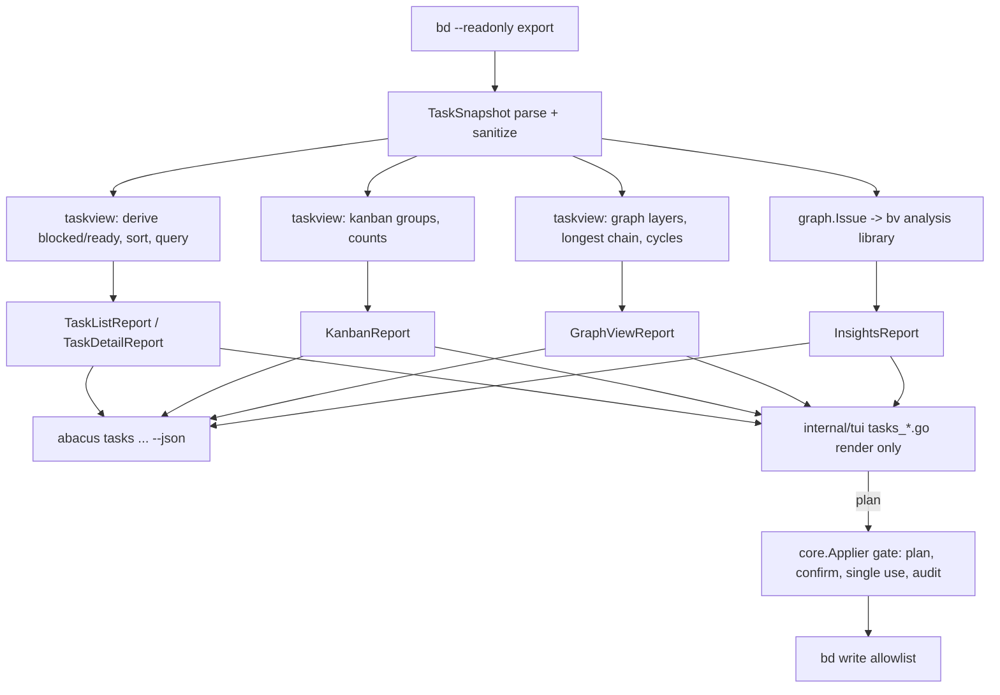

# feat: Tasks workspace (list, kanban, dependency graph, insights, gated edits) over bd

## Goal Capsule

- **Objective:** The Tasks tab becomes a real work browser. Someone running abacus can list, sort, filter and search every task, read one in full (description, comments, what blocks it and what it blocks), see the work as kanban columns, see the dependency graph around a task, read graph insights, and change a task, all from the keyboard at 60x24 and at 100x32 and above, with every write going through the existing plan, confirm, single-use and audit gate.
- **Means:** One snapshot of the tracker read through `bd` (KTD1), typed reports and pure view functions in core (KTD2, KTD3), thin per-view TUI files (KTD7), and the in-process bv analysis library for insights (KTD5). No second data path, no new write mechanism.
- **Authority:** the owner's direction in this session ("we are missing tons of stuff: task list, kanban board, graph, a bunch of stuff"), which supersedes the earlier "no issue browser, hand off to b9s" decision; then the architecture rules already in force (core holds logic, front-ends are thin, UI libraries only in `internal/tui`, no tool names in navigation, text sanitized, no real trackers in tests, schema_version 1 additive); then this plan.
- **Stop conditions:** stop and report if a unit needs a write verb or flag that is not in the allowlist table below; if `bd export` turns out not to carry dependencies, labels and comments (KTD1 falls back, see Risks); if any change would alter an existing key or the write gate's behavior; if a guard test (architecture, theme, tool names, size property) would have to be weakened.
- **Execution profile:** seven units, each one draft PR against `main`, independently reviewable, in the order that shows the owner value first (list and detail, then kanban, then graph). Linux and macOS goldens; the owner runs `./bin/abacus tui --demo` after each merge.
- **Finishes and ships:** implementation, review and merge of each unit. Publishing a release stays an owner action.

Evidence legend used throughout: **[verified]** means read in this repo's code, in the installed `bd` help (bd 1.3.4) or in the public b9s and beads_viewer docs during this planning pass; **[inferred]** is a reasoned guess to be checked in the named unit; **[unverified]** is something this plan could not check without running a tool against a tracker, which was out of bounds here.

---

## Product Contract

### Summary

Build abacus's own Tasks workspace over `bd`. Reads come from one tracker snapshot taken through `bd`; writes go only through the existing gate with exact argv allowlists; graph analysis comes from the bv library already linked into the binary. The b9s `o` handoff stays as a bonus and is not extended.

### Problem Frame

Today Tasks is a summary: counts by state, eight recently changed issues, a graph-insights panel and confirmed new, edit and close forms (`internal/tui/tasks_section.go`, `internal/bd/module.go` `Tasks()` reads `bd status` and `bd list ... -n 8 --brief`) [verified]. The `core.Task` type has id, title, status, priority, type, assignee and updated time, and nothing else: no labels, no created or closed time, no parent, no dependencies, no comments, no description [verified, `internal/core/domains.go`]. There is no way to see a task's description or what blocks it, no sort, no filter, no search, no kanban, no graph, and edits cannot touch assignee, labels, dependencies or comments. `docs/tui.md` states that abacus "deliberately has no issue browser, kanban or dependency graph" and hands off to b9s; the owner has reversed that.

### Requirements

**Reading**

- R1. A task list over the whole tracker with columns id, title, status, priority, type, assignee, labels, age and blocked-by count; stable sorting by eight keys; a filter and search query language; a header that says how many tasks match.
- R2. A task detail: description, comments thread, dependencies both ways, children with a progress bar, parent, labels, timestamps; later, history.
- R3. A kanban view: columns by status with counts and optional lanes, cards that show blockers, keyboard-first, collapsing to a tab strip when narrow; a card move is a gated status update.
- R4. A dependency graph view: the neighborhood of the selected task (what blocks it, what it blocks), a whole-graph view with the longest chain and cycles marked, legible from 60 to 120 columns, with focus and depth control.
- R5. Insights from the library engine inside Tasks: ready work, top picks, bottlenecks, impact depth, plan tracks, cycles.
- R6. Live refresh when the tracker changes, without two reads at once and only while the tab is visible.

**Writing (all through the existing gate)**

- R7. Quick-create, edit, close, reopen, claim; edit priority, assignee and labels; add and remove a blocking dependency; add a comment. Every one is a plan with the exact argv and command shown, a confirm screen, single use, and an audit line before and after.
- R8. Bulk actions on marked tasks (close, status, priority, labels) behind one confirm that lists every task and command.
- R9. Delete is not offered. There is no undo, because bd has none [verified: `bd undo` is an unknown command]; the confirm screen shows the revert command as a hint.

**Cross-cutting**

- R10. Core holds all logic: typed reports (`schema_version` 1, additive JSON) and pure functions for sorting, filtering, query parsing, kanban grouping, graph layout. The CLI prints the same reports; the TUI only renders them.
- R11. Every provider string is sanitized before any width computation; no line is ever wider than the terminal (the existing size property test covers the new views); no tool name appears in navigation, headers or labels.
- R12. No existing key changes meaning. New keys are listed in the key map and a test proves there are no collisions per view.
- R13. Tests never touch a real tracker: fixtures and a fake runner only. Every new write verb has gate tests with a compiling mutant.

### Success Criteria

- At 100x32 and 60x24 the owner can open Tasks, filter to what is ready, open a task, see its blockers, move it on the kanban view and see the graph around it, without reading help.
- The list, the kanban view, the graph and the insights agree on which tasks are blocked and ready, because they read one snapshot (KTD1).
- Each write is visible in the audit log with its exact command; a card moved by an agent a moment earlier is refused, not overwritten (KTD6).

### Scope Boundaries

**In this plan:** the seven units below.

**Deferred or never (with reasons in the inventory):** delete (never), attachments (never, bd has none), undo (never), time-travel and git correlation (later), label dashboards (later), a command prompt and hotkey file (never for now), a phone or browser UI (native clients consume core's JSON instead), steering a running instance (never), the b9s handoff beyond the existing `o` (unchanged).

**Outside this plan:** the in-flight change that removes the bv subprocess and its flag; this plan assumes the library is the only insights path and rebases onto that change.

### Key Decisions

- Own the workspace over `bd`, not a handoff. Governs R1 to R9.
- One snapshot, many views. Governs R1 to R6 and the Success Criteria.
- Writes only through the existing gate, with whole-argv allowlists. Governs R7 to R9.

---

## 1. Feature inventory

Sources: b9s README, `docs/USER_GUIDE.md` and `docs/ARCHITECTURE.md` (v1.3.6 era, MIT); beads_viewer README (v0.27.0 era); `bd --help` and `bd <cmd> --help` of the installed bd 1.3.4; abacus code in `internal/tui`, `internal/core`, `internal/bd`, `internal/graph`, `internal/cli`. Nothing was run except `--help`, in an isolated HOME. "Not documented" means not found in the docs read, not proof of absence.

Proposal key: **now** = in the first four units, **next** = units 5 to 7, **later** = after this plan, **never** = deliberately excluded.

| # | Feature | b9s | bv | abacus today | Proposed |
|---|---|---|---|---|---|
| | **LIST** | | | | |
| 1 | Core columns: id, title, status, priority, type | id, priority, created show by default; creator, assignee, updated, deferred, due via a column picker | id, title, status and priority badges; assignee over 100 cells, a score sparkline over 120, label tags over 140 | A "recent changes" table of at most 8 rows from `bd list --brief -n 8` [verified]; `core.Task` has no labels, created time, parent or dependencies | **now** (U1): full list, no row cap, columns drop by priority as width shrinks |
| 2 | Assignee, labels, age, blocked-by count | Assignee, creator, created, updated as optional columns; blocked-by on board rows | Assignee and labels at wide widths; blocked count on kanban cards | none | **now** (U1): assignee, age, blocked-by count; labels column at 140 and up, always in detail |
| 3 | Sorting | `s`: priority, created, updated, title, status, type, deps, deferred; either direction | `s` cycles five modes (default, created up or down, priority, updated) with a stable id tie-break | fixed: updated, newest first, chosen by `bd list` [verified] | **now** (U1): the eight b9s keys, either direction, stable id tie-break (pure function in core) |
| 4 | Filter and search language | `/` predicates `id: title: status: priority: type: label: assignee: project: branch:`, AND across fields, OR within one, `!` to exclude, Tab completion, find mode, occur mode | `/` fuzzy match over title, id, status, type, assignee, labels; CLI keyword search also reads descriptions | none | **now** (U1): predicate language, same shape as b9s plus `blocked:`, `ready:`, `updated>7d`, `has:comments`; **next**: Tab completion; **later**: find and occur modes, parentheses and an OR keyword. bd has its own `bd query` boolean language [verified] but abacus filters the snapshot in core so it is pure, testable and independent of bd's version |
| 5 | Quick filters (open, ready, blocked, closed, all) | `o` `C` `r` `a` | `o` `c` `r` | none | **now** (U1): `f` cycles presets |
| 6 | Saved filters | none documented (config holds sort and columns) | "recipes": YAML views, built in, per user and per project | none | **next** (U7): named filters in abacus's own config, never inside `.beads/` |
| 7 | Search history | last 100 queries in `.beads/search-history.json` | none documented | none | **next** (U7): in abacus's state directory; abacus never writes into the tracker directory |
| 8 | Hierarchy and epic tree | tree is the default, fold and unfold, flat toggle `t`, show subtree `x` | `E` tree of parent-child links, toggles to blocking chains | none | **next** (U6): indented tree from `parent-child` links, fold with `h` `l`, flat toggle |
| 9 | Bulk select and bulk actions | marks (`Space`, `m`, `V` range), then close, set status, delete act on all marks | none documented | none | **next** (U6): marks, then close, status, priority, labels through one confirm; never bulk delete |
| | **DETAIL** | | | | |
| 10 | Description as markdown | card plus rendered markdown, mermaid diagrams as terminal text | rendered markdown with syntax highlighting | none; only the confirm screen shows the old values of one task | **now** (U1): sanitized, wrapped text with light markdown (headings, bullets, code); **next**: renderer library (Question 6); **later**: mermaid |
| 11 | Comments thread | in detail, above it attachments | scrollable comment history | none | **now** (U1): read; **next** (U5): add a comment through the gate |
| 12 | Dependencies both ways | children numbered 1 to 9 in detail, blockers on board rows | dependencies up to three edges deep, each shown once | insights panel only (blockers that block the most) [verified] | **now** (U1): blocked-by and blocks lists with status glyphs; the graph view (U3) shows the structure |
| 13 | Children and progress bar | epic completion bar with done of total on the board rail | tree view children | none | **now** (U1) in detail, **next** (U6) on epic rows; computed in core from `parent-child` links |
| 14 | History and events | not documented in the user guide | History view: beads correlated with git commits; time-travel diff of two revisions | none | **next** (U7): `bd history ID` and `--events` as a read; **later**: git correlation and time-travel (bv's own engine, not in the linked package) |
| 15 | Attachments | reference comments plus a configured blob store | none documented | none | **never**: bd has no attachment feature [verified: absent from `bd --help`]; b9s's is an app-level convention |
| | **KANBAN** | | | | |
| 16 | Columns by status | `b`: group by status, priority or type | `b`: status, priority or type, 4-line cards | none | **now** (U2): open, in progress, blocked, deferred; closed folded to a count; **next**: group by priority, type, assignee |
| 17 | Lanes (epic, label, assignee) | epic lanes: a rail or full-width rows, completion bar, fold a lane | grouping modes only, no epic lanes | none | **later** (U6 behind Question 1): epic lanes; default is no lanes |
| 18 | WIP and column counts | counts per column; fold a column to a rail | per column: count, P0 and P1 count, blocked count | none | **now** (U2): count, P0 and P1 and blocked counts; **later**: WIP limits in config (bd has no WIP concept [inferred]) |
| 19 | Moving a card | not documented (the board keys list has no move) | not documented (no move key) | none | **now** (U2): `H` and `L` move the card to the previous or next column as a gated status update with a stale-status guard |
| 20 | Responsive and keyboard-first | columns share the width, fold a column with `z`, hide empty ones | toggle empty columns | none | **now** (U2): four columns from 100 cells, below that a tab strip with one column at a time |
| | **DEPENDENCY GRAPH** | | | | |
| 21 | Neighborhood of the selected task | `g`: what blocks it and what it blocks, list navigation | `g`: neighborhood with connectors, panning | none (insights list only) | **now** (U3): boxes and connectors from 100 cells, an indented outline below |
| 22 | Whole graph with critical path highlight | not for issues (the wires view is for Memory Beads) | Insights dashboard and `--robot-graph` JSON, DOT, mermaid; interactive HTML export | insights report has "critical path" but it is a ranked list of per-issue chain heights, not an ordered path [verified, `internal/graph/bvanalyzer.go`] | **now** (U3): whole-graph layers with the longest chain computed in core and marked; no cross-edge routing |
| 23 | Cycle display | health popup only | Cycles panel (strongly connected components) | listed in the insights panel [verified] | **now** (U3): cycle members marked in the graph and listed |
| 24 | Zoom, focus, pan | detail follows the cursor | pan, node selector | none | **now** (U3): depth `[` `]`, focus on the selected node with `enter`, pan with `h` `l` |
| | **INSIGHTS** | | | | |
| 25 | Ready, top picks, critical path, cycles, bottlenecks, tracks | none | ten-panel dashboard with a calculation proof per bead; plan view of parallel tracks | next pick, top blockers, critical path and cycles in a side panel; the report also carries bottlenecks, tracks and totals [verified, `core.InsightsReport`] | **now** (U4): a full Insights view from the library report (picks, bottlenecks by betweenness, impact depth, tracks, cycles, ready and blocked totals); **later**: per-item explanation, HITS and eigenvector panels |
| | **LIVE AND EDIT** | | | | |
| 26 | Live refresh | polls the Dolt working-set hash every 500 ms; file events for JSONL | watches the JSONL or SQLite source | counts and recent list poll every 30 s, insights only on start and `r` [verified, `tasksPollEvery`] | **next** (U7): fingerprinted snapshot poll about every 5 s while visible, never two reads at once |
| 27 | Quick create, edit, close | forms through `bd create`, `bd update`, `bd close` | edit frontmatter in `$EDITOR` | `n` `e` `x` gated forms: create (title, description, priority, type), update (title, description, priority, status), close with reason [verified, `internal/bd/guard.go`] | exists; extended in U5 |
| 28 | Reopen | not documented as a verb | none documented | none (`TaskStatuses` excludes closed) | **next** (U5): `bd reopen` [verified flag `--reason`] |
| 29 | Claim | assignee picker | none | none | **next** (U5): `bd update --claim` [verified] |
| 30 | Add and remove a dependency | not documented in the user guide | none documented | none | **next** (U5): `bd dep add`, `bd dep remove` [verified]; core checks for a cycle first and shows it in the plan |
| 31 | Labels edit | label picker, Labels form field | none documented | none | **next** (U5): add and remove only (`--add-label`, `--remove-label` [verified]); never `--set-labels` |
| 32 | Priority and assignee edit | form fields | none documented | priority yes (edit form), assignee no | **next** (U5): assignee through `update --assignee` with `--if-assignee`; never `--force` |
| 33 | Delete | `Delete` runs `bd delete --force` after a confirm | none | deliberately not offered [verified, `TaskOp` comment] | **never** (Question 3) |
| 34 | Undo | none | none | none; bd has no undo [verified] | **never**; U5 shows the revert command in the confirm screen |
| 35 | Multi-project | header keys 1 to 9, `P` filter, `:project` lists databases, `0` all projects read-only | aggregated workspace views | one tracker: `ABACUS_BD_DIR`, then one at or above the working directory, then the saved `tracker_dir`, then the managed workspace; the shared `TrackerRef` can be re-pointed while running [verified, `internal/core/tracker.go`]; no picker | **now** (U1): show which tracker is open in the panel title; **next** (U7): picker over a saved list of trackers |
| 36 | Export | copy issue as Markdown | `x` Markdown with mermaid; graph as JSON, DOT, mermaid | `abacus tasks --json` prints counts, recent and insights | **now** (U1 to U3): each report as JSON; **next**: Markdown and mermaid from core pure functions (`bd dep tree --format mermaid` exists but core can render it itself [verified flag]) |
| 37 | Help overlay per view | `?` and a tutorial | shortcuts sidebar and tutorials | one global `?` overlay generated from each section's bindings [verified, `docs/tui.md`] | **now** (U1): each view supplies its own bindings, so the overlay is per view for free |
| 38 | Command prompt, hotkey file | `:` prompt, `hotkeys.yaml` | none | none | **never** for now (keyboard model stays fixed) |
| 39 | Phone and browser UI, tmux steering socket | `b9s web`, `b9s ctl` | none | none | **never** here; native clients read core's JSON |
| 40 | Label dashboards (flow matrix, attention) | none | flow matrix and attention views | none | **later** |

### What the two tools do not do that abacus can

Neither documents moving a kanban card, so the gated move (U2) is new, and bd's `--if-status` guard (refuses with exit 13 if the status changed) makes it safe against agents [verified in `bd update --help`]. Neither shows a plan-and-confirm screen with the exact command; abacus's gate already does.

---

## Planning Contract

### Key Technical Decisions

- KTD1. **One snapshot through `bd export`, shared by every view and by the analyzer.** A single read, `bd --readonly export` (JSONL on stdout; "each line is a complete JSON object representing one issue, including its labels, dependencies, and comments" [verified, `bd export --help`]), gives every field the views need. core parses it into a typed `TaskSnapshot`. The list, detail, kanban and graph derive from it; the analyzer is fed the same snapshot (converted to `graph.Issue`), so blocked and ready never disagree between views, and the library no longer depends on a `.beads/issues.jsonl` file existing or being fresh. b9s reads embedded Dolt the same way (runs `bd export`) and documents that it never writes the store itself [verified, b9s user guide]. Open points: whether `--readonly` permits `export` [unverified], the exact JSON field names for labels, comments and parent [inferred; the dependency shape `{issue_id, depends_on_id, type}` is verified in `internal/graph/source.go`], and the size ceiling (the graph reader already caps at 64 MiB [verified]). U1's first step settles these with hand-written fixtures and, with the owner's approval (Question 5), one run in a throwaway tracker.
- KTD2. **Typed reports in `internal/core`, pure functions in a new `internal/taskview`.** Report types (`TaskListReport`, `TaskDetailReport`, `KanbanReport`, `GraphViewReport`) live in core next to `TasksReport`, so JSON, CLI and any native client share them. `internal/taskview` holds the pure functions (parse snapshot, derive blocked and ready, sort, filter, query, group, layout) and imports core, never the reverse; `internal/core/arch_test.go` adds `../taskview` to the scanned directories so it stays free of UI libraries. The name avoids `internal/board` and `core.BoardReport`, which are the agents' message board [verified].
- KTD3. **Query language: field predicates, client-side.** Plain words match id, title and labels (every word must match; subsequence for short words); `field:value` narrows one field; different fields AND, repeated values for one field OR, `!` excludes; `priority:p1`, `priority:<=1`; `assignee:none`, `label:none`; `blocked:true`, `ready:true`; `updated>7d`; `has:comments`. A parser returns a typed `Query` or a typed error with the column of the problem, so the TUI can show it inline. Table tests pin the grammar. Parentheses and an OR keyword are deferred.
- KTD4. **Derived state is explicit.** `blocked_by` is the count of dependencies of type `blocks` whose target is not closed; `ready` means open, not deferred into the future and no unfinished blocker. This matches the analyzer's "actionable" definition [verified in `bvanalyzer.go` comments] and is documented as differing by design from `bd ready` (which also applies parent gates) and from bv's triage score. A dependency-blocked issue keeps stored status `open`; bd says so itself ("dependency-blocked issues stay open; use bd blocked" [verified, `bd query --help`]), so the kanban Blocked column is stored `blocked` and the derived state is a badge and a filter (Question 4).
- KTD5. **Insights come from the library only.** The Insights view renders the existing `core.InsightsReport` (top picks, blockers, critical path as impact depth, bottlenecks, cycles, tracks, totals). The "longest chain" drawn in the graph is computed in core as the longest blocking path over unfinished tasks with an id tie-break, and is labelled "longest chain", because the library's critical-path output is a ranked list of heights, not an ordered path [verified]. Nothing in `internal/graph` changes except a snapshot-backed `IssueSource` next to `FileSource`.
- KTD6. **Writes extend the existing gate; they do not bypass it.** New verbs add a `TaskOp`, validation in core, an exact whole-argv entry in `internal/bd/guard.go` (`--flag=value` form so a value can never read as a flag, ids only through `TaskIDRE`), a plan line set, and gate tests. Moves and assignee changes pass `--if-status=OLD` or `--if-assignee=OLD` so a change made by an agent after the user opened the screen is refused (exit 13 [verified]) and reported as "changed since you opened it", the existing wording. Never used: `delete`, `--force`, `--set-labels`, `--no-cycle-check`, `batch`, `sql`, `edit`.
- KTD7. **File ownership keeps the shared TUI package conflict-free.** U1 adds a view registry in a new `internal/tui/tasks_views.go` and changes `tasks_section.go` only to delegate when in list mode; every later view is a new file plus one registry line. Details in "Parallel work and file ownership".
- KTD8. **Sanitization stays at the edge.** The snapshot parser sanitizes every string with `core.Sanitize` before it enters a report; description and comment text additionally pass the existing control-character rules (newline and tab allowed in bodies only). View code takes sanitized strings and measures with `ansi.StringWidth`.
- KTD9. **Layout is deterministic.** Graph layering and ordering use longest-path layers, then a stable barycenter pass with id tie-breaks, so the same input in any order renders identically (property-tested). Edges are drawn only for the selected node's links; other relationships are shown by id in node labels. This keeps the view legible from 60 to 120 columns (see Question 2).

### High-Level Technical Design



New CLI surface (additive, thin): `abacus tasks list|show ID|kanban|graph [ID] [--json]`; the existing `abacus tasks` summary is unchanged. Final subcommand spelling is settled in U1; the reports carry `schema_version` 1.

### Report sketch (names are proposals, fields additive)

- `TaskRow`: id, title, status, priority, type, assignee, labels, created_at, updated_at, blocked_by (count), blocks (count), ready, parent, depth, child_done, child_total.
- `TaskListReport`: header, query (echoed, normalized), sort, rows, matched, total, tracker (display name only).
- `TaskDetailReport`: row, description, design, notes, acceptance, comments (author, text, created_at), blocked_by and blocks (id, title, status), children with progress.
- `KanbanReport`: group key, columns (key, title, count, p0p1, blocked, limit when configured), cards (id, title, priority, assignee, blocked_by, blocks, age).
- `GraphViewReport`: focus, depth, nodes (id, title, status, layer, order), edges, longest chain, cycles.
- Time-dependent fields (age) take an injected `now` so goldens are stable.

### bd verbs the plan needs (verified against `bd <cmd> --help`, bd 1.3.4)

All written as the argv after `bd [-C DIR]`. Every entry is an exact whole-argv match in the allowlist; values are `--flag=value`; ids go only through `TaskIDRE`.

| Unit | Purpose | argv | Status |
|---|---|---|---|
| U1 | snapshot | read: `--readonly export` (no `-o`, no `--all`) | command and stdout default [verified]; `--readonly` accepted [unverified]; JSON field names for labels, comments and parent [inferred] |
| U1 | one issue, fresh | read: `--readonly show ID --json` (exists) | [verified in code] |
| U2 | move a card | `update ID --json --status=S --if-status=OLD` for S in open, in_progress, blocked, deferred | flags [verified]; exit 13 on a stale guard [verified] |
| U2 | move to closed | `close ID --json --reason=TEXT` (existing verb) | [verified] |
| U2 | move out of closed | `reopen ID --json --reason=TEXT` | `--reason` [verified] |
| U5 | reopen, claim | `reopen ID --json [--reason=T]`; `update ID --json --claim` with the configured actor as global `--actor=NAME` before the verb | `--claim` and global `--actor` [verified] |
| U5 | assignee | `update ID --json --assignee=NAME --if-assignee=OLD`; unassign sends `--assignee=` as its own op | flags [verified]; `--force` never offered |
| U5 | priority | `update ID --json --priority=N` (exists) | [verified in code] |
| U5 | labels | `update ID --json --add-label=L ... --remove-label=L ...` (repeatable) | flags [verified]; label shape `^[A-Za-z0-9][A-Za-z0-9:._/-]{0,63}$` is [inferred] and checked at implementation |
| U5 | comment | `comments add ID TEXT [--author=NAME]` | text is positional [verified usage]; a text starting with `-` could be read as a flag: use a `--` terminator if bd's CLI honors it [unverified], otherwise refuse such text with a clear message |
| U5 | add, remove dependency | `dep add ID BLOCKER [--type=blocks]`; `dep remove ID BLOCKER` | usage [verified]; bd checks cycles per edge by default [verified], so `--no-cycle-check` is never sent; external refs (`external:...`) fail `TaskIDRE` and are refused |
| U6 | reparent | `update ID --json --parent=PARENT` (empty removes) | flag [verified] |
| U6 | bulk | one argv per task under one confirm (close, status, priority, labels); at most 25 per confirm | `bd update` takes several ids but is not atomic and reports failures only on stderr [verified], so one argv per task keeps outcomes attributable |
| U7 | history | read: `--readonly history ID --json --limit=N`; `--readonly history ID --events` | flags [verified]; JSON shape [unverified] |

### Assumptions

- A1. The installed bd 1.3.4 is representative; the existing `supportedSchema` check on `bd status` stays and U1 adds an equivalent check on the export's first record [inferred].
- A2. A tracker of a few thousand issues fits one export in memory and one analysis in milliseconds (the assessment measured about 5 ms for 200 issues [verified in `docs/plans/2026-11-22-graph-core-assessment.md`]); larger trackers hit the 64 MiB cap and say so.
- A3. Descriptions and comments are plain text or markdown written by agents and people; they are untrusted.
- A4. The shared TUI package is being changed by another agent in small PRs; goldens for Tasks are owned by this plan from U1 onward.

### Risks and Dependencies

| Risk | Mitigation |
|---|---|
| `bd export` is slow or locks an embedded Dolt store during an agent's write | measure in U1; fall back to `bd list --json --all --flat -n 0` plus the dependency read; show read duration in Doctor; refresh never overlaps |
| Export lacks a field the views need (labels, comments, parent) | U1 stops and reports (stop condition); fallback is `bd show` per visible task (comments) and `bd list --json` (labels) |
| `ready` differs from `bd ready` | documented (KTD4); a parity test compares fixtures captured once from `bd ready` in the approved throwaway tracker; the header says "ready" with the local meaning |
| Hostile text in descriptions, comments, labels | KTD8; hostile fixtures in every view's width test; bidi and escape characters rendered as visible escapes |
| Markdown renderer adds dependency size or golden instability | measure binary growth against the 6 MB budget in the assessment before adopting; fixed style, no terminal queries (Question 6) |
| Merge conflicts with the other TUI agent | file ownership table; U1 lands first and alone touches shared files |
| The bv-subprocess removal PR changes insights wiring | U1 and U4 rebase onto it; U4 must not start before it merges |
| Position of a verb's positional text (comment) | allowlist matches whole argv by position; tests include text starting with `-`, `--` and `=` |

---

## Responsive and visual design

Breakpoints reuse the named constants in `internal/tui/layout.go` (`bpMin` 40, `bpCompact` 60, `bpWide` 100, `bpUltra` 140; `hMin` 12, `hRule` 16, `hSummary` 24, `hTall` 40) [verified in `docs/tui.md`]; no new threshold is introduced.

| Width | List | Kanban | Graph |
|---|---|---|---|
| under 40 or 12 rows | existing "terminal too small" body | same | same |
| 40 to 59 | one panel; columns id, title, status, priority only | tab strip, one column | outline only |
| 60 to 99 | one panel; adds dependency count; `enter` drills into detail | tab strip, one column | outline (indented, always legible) |
| 100 to 139 | list beside detail (list 60%, detail 40%, as `duo`) | four columns side by side | boxes and connectors beside a chain panel |
| 140 and up | adds assignee, age and labels columns | same, wider cards | same, more depth shown |

Heights follow the existing rules: the header rule drops under 16 rows, panels are as tall as their content plus air up to the body height, and clipped content ends in a `↕ +N more` row. The view strip (`List Kanban Graph Insights`, the active one in brackets so it reads without color) and the query line sit above the panels. Status glyphs: `○` open, `◐` in progress, `●` blocked, `✓` closed, `◇` deferred (the first four are bd's own icons [verified, `bd graph --help`]; the fifth replaces an ambiguous-width glyph). Blocked-by is `⊘N`, blocks is `→N`. Every glyph pairs with a word or position, so `NO_COLOR` loses nothing. The mockups below are plain text; real renders go through the theme (focus by border color and the `▸` marker).

### List and detail

100x32, list beside detail:

```text
 abacus  Board [Tasks] Leases Queues Doctor
────────────────────────────────────────────────────────────────────────────────────────────────────
 [List]  Kanban  Graph  Insights                                      41 tasks · 9 ready
 / status:open status:in_progress !label:later    11 of 41 · sort: priority ↑
╭─ ▸ Tasks ────────────────────────────────────────────────╮╭─ ac-45 ──────────────────────────────╮
│   id    title                    st P type  who  age dep ││ ac-45  feature                       │
│   ac-41 Lease heartbeat misses … ◐ P0 bug   ada  2h  →3  ││ Kanban cards show blockers           │
│   ac-38 Queue filter ignores ma… ○ P1 bug   -    1d      ││                                      │
│ ▸ ac-45 Kanban cards show block… ○ P1 feat  mei  3d  ⊘2  ││ ○ open   P1   mei   3d               │
│   ac-33 Split graph source from… ◐ P1 task  ada  4d  →2  ││ labels  ui, tasks                    │
│   ac-12 Tasks workspace (epic) … ○ P1 epic  mei  9d      ││ parent  ac-12 Tasks workspace        │
│   ac-47 Doctor: stale export wa… ● P2 bug   -    6d  ⊘1  ││                                      │
│   ac-29 Document the write gate  ○ P2 task  -    5d      ││ Blocked by (2)                       │
│   ac-50 Saved filters            ○ P3 feat  -    2d  ⊘1  ││   ◐ ac-33 Split graph source…        │
│   ac-52 Help overlay per view    ○ P3 task  -    1d  ⊘1  ││   ● ac-47 Doctor: stale expo…        │
│   ac-44 Markdown in detail pane  ○ P3 feat  -    8d      ││ Blocks (0)                           │
│   ac-36 Verify bd flags against… ◇ P3 chore mei  12d     ││                                      │
│                                                          ││ Card shows ⊘N and the blocker        │
│                                                          ││ ids; moving it to in progress        │
│                                                          ││ warns while a blocker is open.       │
│                                                          ││                                      │
│                                                          ││ Comments (2)                         │
│                                                          ││   mei  Needs the core snapshot       │
╰──────────────────────────────────────────────────────────╯╰──────────────────────────────────────╯


 j/k move · / search · s sort · v view · n new · e edit · x close · ? help · q quit
```

60x24, single pane (`enter` drills into the detail, `esc` returns):

```text
 abacus  Board [Tasks] Leases Queues Doctor
────────────────────────────────────────────────────────────
 [List] Kanban Graph Insights         41 tasks · 9 ready
 / status:open !label:later    11 of 41 · sort: priority ↑
╭─ ▸ Tasks ────────────────────────────────────────────────╮
│   id    title                                   st P dep │
│   ac-41 Lease heartbeat misses on resume        ◐ P0 →3  │
│   ac-38 Queue filter ignores machine            ○ P1     │
│ ▸ ac-45 Kanban cards show blockers              ○ P1 ⊘2  │
│   ac-33 Split graph source from export          ◐ P1 →2  │
│   ac-12 Tasks workspace (epic) 3/8              ○ P1     │
│   ac-47 Doctor: stale export warning            ● P2 ⊘1  │
│   ac-29 Document the write gate                 ○ P2     │
│   ac-50 Saved filters                           ○ P3 ⊘1  │
│   ac-52 Help overlay per view                   ○ P3 ⊘1  │
│   ac-44 Markdown in detail pane                 ○ P3     │
│   ac-36 Verify bd flags against help            ◇ P3     │
│                                                          │
│                                                          │
│                                                          │
│                                                          │
│                                                          │
╰──────────────────────────────────────────────────────────╯
 j/k move · enter open · / search · v view · ? help · q quit
```

60x24, detail after `enter`:

```text
 abacus  Board [Tasks] Leases Queues Doctor
────────────────────────────────────────────────────────────
 List Kanban Graph Insights         (detail)

╭─ ▸ ac-45 ────────────────────────────────────────────────╮
│ ac-45  feature          ○ open  P1                       │
│ Kanban cards show blockers                               │
│ mei · 3d · ui, tasks · parent ac-12                      │
│                                                          │
│ Blocked by (2)                                           │
│   ◐ ac-33 Split graph source from export                 │
│   ● ac-47 Doctor: stale export warning                   │
│ Blocks (0)                                               │
│                                                          │
│ Card shows ⊘N and the blocker ids;                       │
│ moving it to in progress warns while                     │
│ a blocker is still open.                                 │
│                                                          │
│ Comments (2)                                             │
│   mei  Needs the core snapshot first                     │
│   ada  Agreed, after ac-33                               │
│                                                          │
╰──────────────────────────────────────────────────────────╯
 j/k scroll · esc back · e edit · x close · ? help · q quit
```

### Kanban

100x32, four columns; `H` and `L` move the selected card to the previous or next column (a plan and confirm screen follows); `closed 12 hidden` is a folded fifth column (`Z` shows it):

```text
 abacus  Board [Tasks] Leases Queues Doctor
────────────────────────────────────────────────────────────────────────────────────────────────────
 List [Kanban] Graph Insights                                      41 tasks · 9 ready
 lanes: none · closed 12 hidden (c) · / status:open,in_progress,blocked,deferred
╭─ ▸ Open 5 ────────────╮╭─ In progress 2/5 ─────╮╭─ Blocked 1 ───────────╮╭─ Deferred 1 ──────────╮
│   ac-38 P1            ││   ac-41 P0 ada        ││   ac-47 P2  ⊘1        ││   ac-36 P3 mei        │
│   Queue filter machine││   Lease heartbeat mis…││   Doctor: stale export││   Verify bd flags     │
│                       ││                       ││                       ││                       │
│ ▸ ac-45 P1 mei  ⊘2    ││   ac-33 P1 ada  →2    ││                       ││                       │
│   Kanban cards show b…││   Split graph source  ││                       ││                       │
│                       ││                       ││                       ││                       │
│   ac-12 P1 mei        ││                       ││                       ││                       │
│   Tasks workspace 3/8 ││                       ││                       ││                       │
│                       ││                       ││                       ││                       │
│   ac-29 P2            ││                       ││                       ││                       │
│   Document the write …││                       ││                       ││                       │
│                       ││                       ││                       ││                       │
│   ac-50 P3  ⊘1        ││                       ││                       ││                       │
│   Saved filters       ││                       ││                       ││                       │
│                       ││                       ││                       ││                       │
│                       ││                       ││                       ││                       │
│                       ││                       ││                       ││                       │
│                       ││                       ││                       ││                       │
│                       ││                       ││                       ││                       │
│                       ││                       ││                       ││                       │
╰───────────────────────╯╰───────────────────────╯╰───────────────────────╯╰───────────────────────╯


 h/l column · j/k card · H/L move card · enter detail · v view · ? help · q quit
```

60x24, columns collapse to a tab strip; `h` `l` change the column (never the left and right arrows, which stay tab navigation):

```text
 abacus  Board [Tasks] Leases Queues Doctor
────────────────────────────────────────────────────────────
 List [Kanban] Graph Insights         41 tasks · 9 ready
 ‹ Open 5 │[In progress 2]│ Blocked 1 │ Deferred 1 ›
╭─ ▸ In progress  2 of 5 (wip limit) ──────────────────────╮
│ ▸ ac-41 P0 ada                                           │
│   Lease heartbeat misses on resume                       │
│                                                          │
│   ac-33 P1 ada  →2                                       │
│   Split graph source from export                         │
│                                                          │
│                                                          │
│                                                          │
│                                                          │
│                                                          │
│                                                          │
│                                                          │
│                                                          │
│                                                          │
│                                                          │
╰──────────────────────────────────────────────────────────╯


 h/l column · j/k card · H/L move · v view · ? help · q quit
```

### Dependency graph

100x32, neighborhood of the selected task: blockers above, dependents below, edges drawn only for this node (KTD9), longest chain and cycles on the right:

```text
 abacus  Board [Tasks] Leases Queues Doctor
────────────────────────────────────────────────────────────────────────────────────────────────────
 List Kanban [Graph] Insights                                      41 tasks · 9 ready
 focus ac-45 · depth 3 · blocks only · layout: neighborhood
╭─ ▸ Graph  ac-45 ───────────────────────────────────────────╮╭─ Chain ────────────────────────────╮
│                                                            ││ longest chain (4):                 │
│    ┌──────────────────┐                                    ││ ac-31 ✓ → ac-33 → ac-45            │
│    │ ✓ ac-31 Snapshot │                                    ││   → ac-50                          │
│    └────────┬─────────┘                                    ││                                    │
│             │                                              ││ cycles: none                       │
│    ┌────────┴─────────┐   ┌──────────────────┐             ││ blockers open: 2                   │
│    │ ◐ ac-33 Split gr…│   │ ● ac-47 Doctor … │             ││ unblocks: 2 when closed            │
│    └────────┬─────────┘   └────────┬─────────┘             ││                                    │
│             └──────────┬───────────┘                       ││ ✓ closed  ◐ active  ● blocked      │
│                        │                                   ││ ○ open  ◇ deferred                 │
│             ╔══════════╧═══════════╗                       ││ ╔═╗ selected  │ blocks             │
│             ║ ○ ac-45 Kanban cards ║                       ││                                    │
│             ╚══════════╤═══════════╝                       ││                                    │
│                 ┌──────┴──────┐                            ││                                    │
│       ┌─────────┴──────┐ ┌────┴───────────┐                ││                                    │
│       │ ○ ac-50 Saved… │ │ ○ ac-52 Help … │                ││                                    │
│       └────────────────┘ └────────────────┘                ││                                    │
│                                                            ││                                    │
│                                                            ││                                    │
│                                                            ││                                    │
╰────────────────────────────────────────────────────────────╯╰────────────────────────────────────╯


 j/k node · enter focus · g whole graph · [ ] depth · v view · ? help · q quit
```

60x24, the same data as an outline (the layout that is always legible); `g` toggles to the whole-graph layers:

```text
 abacus  Board [Tasks] Leases Queues Doctor
────────────────────────────────────────────────────────────
 List Kanban [Graph] Insights         41 tasks · 9 ready
 focus ac-45 · depth 3 · blocks only
╭─ ▸ Graph  ac-45  (outline) ──────────────────────────────╮
│ blocked by                                               │
│   ◐ ac-33 Split graph source from export                 │
│     ✓ ac-31 Snapshot                                     │
│   ● ac-47 Doctor: stale export warning                   │
│                                                          │
│ ▸ ac-45 Kanban cards show blockers    ○ P1               │
│                                                          │
│ blocks                                                   │
│   ○ ac-50 Saved filters                                  │
│   ○ ac-52 Help overlay per view                          │
│                                                          │
│ longest chain  ac-31 → ac-33 → ac-45 → ac-50             │
│ cycles         none                                      │
│                                                          │
│                                                          │
│                                                          │
╰──────────────────────────────────────────────────────────╯

 j/k node · enter focus · g whole · v view · ? help · q quit
```

### Key map

Existing keys keep their meaning [verified, `docs/tui.md` and `internal/tui/keys.go`]: `tab` `right` and `shift+tab` `left` (tabs), `1`-`9` (jump to tab), `j` `k` and arrows (move), `n` `e` `x` (new, edit, close), `o` (full view handoff on Tasks), `i` `s` (only while a tab is guided), `r` (refresh), `enter` and `esc` (drill and back), `/` (filter), `?` (help), `q` and `ctrl+c`, and `y` and `n` or `esc` on the confirm screen. `w` is reserved for the workspace jump in the redesign plan and stays unbound here.

New keys on Tasks. A key that applies to "the task" applies to every marked task when marks exist, otherwise to the cursor task; each write opens the usual form or confirm screen.

| Key | Where | Action | Unit |
|---|---|---|---|
| `v` `V` | all views | next, previous view (List, Kanban, Graph, Insights) | U1 |
| `s` `S` | List | cycle sort key, reverse direction | U1 |
| `s` | Kanban | cycle grouping (status, priority, type, assignee) | U2 |
| `/` | List, Kanban | edit the query; `esc` clears; `enter` keeps it | U1 |
| `f` | List, Kanban | cycle presets: open, ready, blocked, closed, all | U1 |
| `enter` `esc` | List | open the detail (narrow), back | U1 |
| `h` `l` | Kanban | previous, next column | U2 |
| `H` `L` | Kanban | move the card to the previous, next column (gated) | U2 |
| `Z` | Kanban | show or hide the closed column | U2 |
| `g` | List, Kanban | open the graph on this task | U3 |
| `g` | Graph | toggle neighborhood and whole graph | U3 |
| `[` `]` | Graph | less, more depth | U3 |
| `h` `l` | Graph | pan | U3 |
| `enter` | Graph | refocus on the selected node | U3 |
| `X` | List, Kanban | reopen | U5 |
| `C` | List, Kanban | claim (assign to the configured actor, in progress) | U5 |
| `a` | List, Kanban | assign | U5 |
| `p` | List, Kanban | set priority | U5 |
| `t` | List, Kanban | edit labels (add, remove) | U5 |
| `c` | List, Kanban, detail | add a comment | U5 |
| `d` | List, Kanban, detail | add or remove a blocking dependency | U5 |
| `space` `U` | List | mark, clear marks | U6 |
| `h` `l` | List (tree on) | collapse, expand | U6 |
| `T` | List | toggle tree and flat | U6 |
| `P` | Tasks | switch tracker | U7 |
| `ctrl+r` | Tasks | history of the cursor task | U7 |

A test (`TestTasksKeysDoNotCollide`) enumerates each view's bindings in each mode and fails on a duplicate within a view, a clash with a global key, or a binding of `w`. Footer and `?` overlay are generated from the same `key.Binding` values, so they cannot drift.

---

## Implementation Units

Order: U1, then U2, U3 and U4 in parallel, then U5, then U6 and U7 in parallel. Each unit is one draft PR with a CHANGELOG entry, goldens regenerated with `-update` and reviewed, and a compiling mutant for every new guard.

### U1. Snapshot, list, detail, sort, query (core first, then TUI)

- **Goal:** the owner opens Tasks and sees every task, sorted and filterable, with a detail pane.
- **Waits on:** the in-flight bv-subprocess removal PR if it touches insights wiring; otherwise nothing. Runs alone first.
- **Parallel with:** nothing (it creates the shared seams).
- **Files (core):** `internal/core/tasks_view.go` (report types, `TaskSource` interface), new `internal/taskview/{snapshot,derive,sort,query,list,detail}.go` with tests and `testdata/*.jsonl` fixtures, `internal/bd/module.go` (a `Snapshot` method, read allowlist entry for `--readonly export`), `internal/bd/guard.go` (read allowlist only), `internal/graph/source.go` (a `SnapshotSource` that wraps the same snapshot; `FileSource` kept as fallback), `internal/cli` (additive `tasks list` and `tasks show`), `internal/core/arch_test.go` (scan `../taskview`), `internal/demo` (demo snapshot of invented tasks).
- **Files (TUI):** new `internal/tui/tasks_views.go` (view registry and switcher), `tasks_list.go`, `tasks_detail.go`; `tasks_section.go` changes only to delegate list mode to the registry and keep forms, confirm and `o` untouched. `docs/tui.md` and `README.md` stop saying there is no issue browser.
- **Approach:** parse and sanitize the export into `TaskSnapshot`; derive blocked, ready, children and progress; implement the eight sorts and the query grammar (KTD3, KTD4) as pure functions over the snapshot with an injected `now`; the list view uses `table.fitRows` and `listNav`, the detail uses `panel` and `duo`; description rendering is sanitized wrapped text with light markdown until Question 6 is answered; the panel title shows the tracker's directory name only.
- **Acceptance:** all tasks listed (no 8-row cap) with the columns in the responsive table; sort keys and direction work and are stable; `/` filters live and shows a typed error under the query line for a bad query; `f` cycles presets; `enter` and `esc` drill at under 100 columns; detail shows description, comments, blockers both ways, children with a bar; the header says "N of M"; insights panel and the n, e, x forms still work unchanged.
- **Tests:** query-language table tests (every predicate, negation, OR within a field, bad input with column, hostile text); sort tests (stable ties, every key, either direction); derive tests (blocked, ready, parent-child, closed blockers, unknown dependency types, missing targets); parser fixtures including a custom status and an unknown field; goldens at 100x32 and 60x24 (plus the existing grid) through the fixed color profile; layout invariants (no line wider than the terminal across 1x1 to 300x100, hostile fixtures); key collision test; a fake-runner test that the export read argv is exactly the allowlisted one and that a write argv is refused on the read path.
- **bd verbs:** read only (`--readonly export`).
- **Risks:** export shape and `--readonly` acceptance (KTD1, Question 5); golden churn on every Tasks golden; PR size, with a split line at core (`taskview`, source, CLI) and TUI if review exceeds about 1500 lines.

### U2. Kanban view with gated moves

- **Goal:** the owner sees the work as columns and moves a card with a confirm.
- **Waits on:** U1. **Parallel with:** U3, U4 (different new files).
- **Files:** `internal/taskview/kanban.go` (+tests), `internal/core/tasks_view.go` (add `KanbanReport`), `internal/core/taskwrite.go` (`IfStatus` on `TaskChange`, a reopen op), `internal/bd/guard.go` (allowlist entries for `--if-status` and `reopen`), `internal/tui/tasks_kanban.go`. The name `tasks_kanban.go` is used instead of `tasks_board.go` because `Board` is already the agents' message board and `tasks_board_layout_test.go` tests that tab.
- **Approach:** group the snapshot into columns with counts, P0 and P1 counts and blocked counts; a move builds a `TaskChange` with `IfStatus` set to the status at open time and goes through the existing form-less confirm screen, which also shows "blocked by ac-33 (open)" when the card has an unfinished blocker; a move into or out of closed uses close or reopen with a reason prompt.
- **Acceptance:** four status columns from 100 cells and a tab strip below; counts per column; `H` and `L` open the confirm screen with the exact command; a stale-status refusal (exit 13) shows "changed since you opened it" and leaves the card where it is; nothing is written before `y`.
- **Tests:** column and count logic (empty columns, custom status, closed folded, group by priority and type); move planning (every legal pair, closed paths, guard value); gate tests for the new verbs: unconfirmed plan never runs, single use, audit before and after, allowlist refuses `--force` and a missing `--if-status`; compiling mutants for each; goldens at 100x32 and 60x24; width invariants.
- **bd verbs:** `update ID --json --status=S --if-status=OLD`, `close`, `reopen` (table above).
- **Risks:** `--if-status` argument order and acceptance with `--json` (check with a fake runner, then once in the approved throwaway tracker).

### U3. Dependency graph view

- **Goal:** the owner sees what blocks a task and what it blocks, and the longest chain.
- **Waits on:** U1. **Parallel with:** U2, U4.
- **Files:** `internal/taskview/graph.go` (+tests: layers, longest chain, cycles, outline, boxes), `internal/core/tasks_view.go` (`GraphViewReport`), `internal/cli` (`tasks graph`), `internal/tui/tasks_graph.go`.
- **Approach:** BFS from the focus to the chosen depth over blocking edges (plus parent-child shown dotted in the outline only); layers by longest path; barycenter ordering with id tie-breaks; the box renderer places nodes on a character canvas and draws connectors only for the focus node (KTD9); the outline renders any width; the longest chain and cycles are marked in both; whole-graph mode lists layers with the chain highlighted and pages with `h` `l`.
- **Acceptance:** neighborhood renders at 100 columns with boxes and at 60 as an outline; selecting another node and `enter` refocuses; depth keys work; a cycle fixture renders and is flagged, never loops; no line wider than the terminal at any size.
- **Tests:** layout determinism (shuffle the input order 100 times, identical output); layering and chain tests on fixtures (diamond, long chain, two components, cycle, self-loop, missing target); outline golden at 60x24 and box golden at 100x32; width invariants with 200-character titles and wide runes; a 1000-node fixture renders under a time bound.
- **bd verbs:** none (read-only).
- **Risks:** legibility of dense graphs, mitigated by edges-for-focus-only and by the outline fallback; recorded as Question 2.

### U4. Insights view from the library

- **Goal:** one full Insights view and picks that open the task.
- **Waits on:** U1 and the bv-removal PR. **Parallel with:** U2, U3.
- **Files:** `internal/graph/snapshotsource` wiring (already added in U1; U4 switches the insights provider to it), `internal/tui/tasks_insights.go`; the current insights side panel on the list view becomes a one-line "next pick" strip.
- **Approach:** render `InsightsReport`: next picks with reasons and unblock counts, blockers, bottlenecks, impact depth, tracks, cycles, ready and blocked totals; `enter` on any id opens its detail, `g` its graph. Insights refresh on `r` and on a snapshot change, because they are cheap in-process (about 5 ms per 200 issues [verified]) and no longer spawn processes.
- **Acceptance:** each section renders or says why it is empty; works with the library as the only engine; no mention of a tool name in labels.
- **Tests:** golden per breakpoint with a fixture report; report parity test (the same snapshot gives the same picks as the analyzer called directly); degraded states (cycle present so no critical path; empty tracker); width invariants.
- **bd verbs:** none.
- **Risks:** bv API churn (pinned, one adapter file, per the assessment); view depends on the library's definitions of actionable and keystone (documented in `docs/tool-contract.md`).

### U5. Edit actions through the gate

- **Goal:** change labels, priority, assignee, dependencies, add a comment, claim, reopen.
- **Waits on:** U1 and U2 (shares `taskwrite.go` and `guard.go` with U2's guard work).
- **Parallel with:** nothing that edits `taskwrite.go` or `guard.go`; U6 and U7 may start TUI work but must not touch those files until U5 merges.
- **Files:** `internal/core/taskwrite.go` (new ops, validation, plan lines, revert hint), `internal/bd/guard.go` and `module.go` (allowlist entries and `BuildTaskArgv` cases), `internal/tui/tasks_edit.go` (small forms and pickers: labels, assignee, comment, dependency chooser), `internal/demo`.
- **Approach:** one `TaskOp` per verb; every verb gets validation (ids, label and actor shapes, comment size and control characters, no self-dependency, cycle pre-check on the snapshot), a plan with the exact command, and a revert hint computed from `Before` (for example "to revert: bd update ac-45 --remove-label=ui"); no undo is implied.
- **Acceptance:** each action opens its form or picker, then the confirm screen with the exact command; `y` applies once; a stale `--if-*` guard is reported plainly; the audit log has the attempt and the outcome; none of the never-used flags can be produced.
- **Tests:** for every verb: validation table; plan lines; exact argv; allowlist accepts the exact argv and rejects variants (extra flag, reordered, other id, `--force`, `--set-labels`, `--no-cycle-check`, a text starting with `-`); unconfirmed never runs; single use; audit failure blocks; unknown outcome stays typed; a compiling mutant per guard (drop the confirmed check, widen the allowlist, skip the audit). Goldens for each form at 100x32 and 60x24.
- **bd verbs:** reopen, claim, assignee, labels, comment, `dep add`, `dep remove` (table above).
- **Risks:** comment text positional edge; claim's actor (uses the configured actor, refuses when none is set rather than guessing).

### U6. Hierarchy, epics and bulk operations

- **Goal:** work by epic and act on many tasks at once.
- **Waits on:** U1 (tree) and U5 (bulk reuses the verbs). **Parallel with:** U7.
- **Files:** `internal/taskview/tree.go` (+tests), `internal/core/taskwrite.go` (a bulk plan holding up to 25 single plans; one confirm; per-task audit and result), `internal/tui/tasks_tree.go`, `tasks_marks.go`; kanban epic lanes (`internal/taskview/kanban.go`, behind Question 1).
- **Approach:** indented tree from `parent-child` links with fold state, flat toggle, epic rows with progress bars; marks by `space`; edit keys act on marks; the bulk confirm lists every task and command and is clipped-safe like the existing confirm (cannot be answered unless fully visible); execution is sequential, continues past a failure, and reports "3 of 5 applied" with the failures named.
- **Acceptance:** tree and flat views agree on the same tasks; folding persists across refreshes by id; a bulk close of five tasks shows five commands and one `y`; a failure on one leaves the others applied and is reported.
- **Tests:** tree build (orphans, cycles in parent links, deep nesting); progress math; bulk plan (cap, empty, duplicates, mixed outcomes, unknown outcome); every bulk verb through the gate tests with mutants; goldens.
- **bd verbs:** `update --parent`, and the U5 verbs repeated per task.
- **Risks:** bulk confirm length at 60x24 (uses the existing clipped-confirm rule).

### U7. History, live refresh, saved filters, project switcher

- **Goal:** polish that makes the workspace feel live and personal.
- **Waits on:** U1. **Parallel with:** U6 (separate files; avoids `taskwrite.go`).
- **Files:** `internal/taskview/fingerprint.go`, `internal/core/tasks_view.go` (history report), `internal/bd/module.go` (history read), `internal/core/config.go` (additive `saved_filters` and `trackers`), `internal/core/searchhistory.go` (state directory), `internal/tui/tasks_history.go`, `tasks_projects.go`, and the refresh tick in `tasks_section.go`.
- **Approach:** a snapshot fingerprint (hash of the export bytes) so an unchanged tracker redraws nothing; a poll about every 5 s while the tab is visible and idle, doubling after a slow read, never two reads at once; history for the cursor task from `bd history` (commit snapshots) and `--events`; saved filters and search history in abacus's own config and state files (never `.beads/`); `P` opens a picker over the saved tracker list and re-points the shared `TrackerRef` for the session (making it permanent stays the existing `abacus config set tracker_dir`).
- **Acceptance:** an agent's change appears within the poll interval with the cursor and marks kept by task id; an unchanged tracker costs one read per interval and no redraw; history shows entries or "no history here"; saved filters round-trip; switching tracker reloads every view and updates the panel title.
- **Tests:** fingerprint (stable, changes on any field), poll scheduling with a fake clock (no overlap, backoff, paused when hidden), selection survival across refresh (the same property tests Leases already use), history parser fixtures, config round-trip and lock behavior, project switch with two fixture trackers.
- **bd verbs:** `history` reads only.
- **Risks:** history JSON shape and Dolt dependence [unverified]; poll cost on large trackers (the interval backs off).

### Parallel work and file ownership

| Area | Files | Owner unit | Rule for others |
|---|---|---|---|
| Report types | `internal/core/tasks_view.go` | U1 creates; each unit appends its own type | append only |
| Pure view logic | `internal/taskview/*.go` | one file per unit (`list`, `kanban`, `graph`, `tree`) | do not edit another unit's file |
| View registry | `internal/tui/tasks_views.go` | U1 | later units add one line each |
| Views | `tasks_list.go`, `tasks_detail.go` (U1), `tasks_kanban.go` (U2), `tasks_graph.go` (U3), `tasks_insights.go` (U4), `tasks_edit.go` (U5), `tasks_tree.go` and `tasks_marks.go` (U6), `tasks_history.go` and `tasks_projects.go` (U7) | per unit | new files only |
| Write gate | `internal/core/taskwrite.go`, `internal/bd/guard.go`, `internal/bd/module.go` | U2 (guard flag), then U5, then U6 | strictly sequential |
| Shared TUI files | `model.go`, `keys.go`, `section.go`, `layout.go`, `theme.go`, `tasks_section.go` | the other agent, except U1's delegation edit and U7's tick | keep edits minimal; ask before touching |
| Tasks goldens | `internal/tui/testdata/golden/tasks*` | this plan from U1 on | the other agent avoids Tasks goldens during U1 |

---

## Verification Contract

| Check | Command | Applies |
|---|---|---|
| Format and vet | `gofmt -l .`, `go vet ./...` | every unit |
| Tests, isolated | `env HOME=<tmp> XDG_STATE_HOME=<tmp>/s XDG_CONFIG_HOME=<tmp>/c XDG_DATA_HOME=<tmp>/d GOCACHE=<private> go test ./...` | every unit |
| Goldens | `go test ./internal/tui` and `-update` reviewed, at 100x32 and 60x24 plus the existing grid | every unit with a view |
| Width and hostile text | the size property test across 1x1 to 300x100 with hostile fixtures for every new view | every unit with a view |
| Mutants | a compiling mutant per new guard (confirmed check, allowlist entry, audit, guard flag, query parse, layout order) | every unit |
| Real TUI | detached tmux at 100x32, 60x24, 40x12 and 160x50 with a fake `bd` on `PATH` that leaves a marker if a write is attempted; never `o`; isolated HOME and XDG | every unit with a view |
| Independent review | `ce-code-review` before every merge, plus the checks the repo already requires | every unit |
| Safety | no `bd`, `bv`, `lambe` or `beads-lease` against real data; fixtures and fake runners only | always |

## Definition of Done

- Every unit's scenarios exist and pass; every new guard has a killed mutant.
- Goldens regenerated and reviewed; `docs/tui.md` and the README describe the workspace and no longer say there is no issue browser; the `o` handoff text says it is optional.
- CHANGELOG updated per unit; PR bodies say what was verified and what was not (never run against a real tracker; goldens through a fixed color profile).
- Each unit merged, `bin/abacus` rebuilt from `main`, and the owner told how to run the demo.

## Questions for the owner

1. **Kanban lanes by default?** Recommended: no lanes. Flat status columns first; `s` cycles the grouping (status, priority, type, assignee); epic lanes arrive in U6 behind a toggle, because lanes cost vertical space at 24 rows and most trackers have few epics.
2. **Graph layout style?** Recommended: a neighborhood view (blockers above, dependents below, connectors drawn only for the selected node) from 100 columns and an indented outline below that, plus a whole-graph layer list with the longest chain marked. A fully routed whole-graph drawing is not attempted: it stops being legible between 60 and 120 columns once edges cross.
3. **Expose delete?** Recommended: no. bd has no undo [verified], the gate already says delete is deliberately not offered, and `close` with a reason retires a task. Revisit only if you ask, and then as its own confirm with the task title typed back.
4. **Blocked column: stored status or derived?** Recommended: stored. The column holds tasks whose status is `blocked`, because that is what a card move writes; a task held back only by an open dependency keeps status `open` (bd's own behavior) and shows `⊘N` and the filter `blocked:true`. A derived column would make a move ambiguous.
5. **May I run one verification of `bd export` and `bd schema` inside a throwaway tracker?** This plan could not run bd against any tracker, so the export's field names (labels, comments, parent), whether `--readonly` allows `export`, and the `history --json` shape are unverified. Recommended: yes, as the first step of U1, in a `mktemp` directory with an isolated HOME and `bd init` there, never your fleet tracker; the result becomes the fixtures. If you say no, U1 uses hand-written fixtures from the verified pieces and keeps `list --json` as the fallback read.
6. **Markdown renderer?** Recommended: adopt a maintained library (glamour) behind one file in `internal/tui`, fixed style, after measuring its binary growth against the 6 MB budget; until then U1 ships sanitized wrapped text with light markdown. This follows your preference for libraries over hand-rolled parsers; the cost is dependency size and some golden churn.
